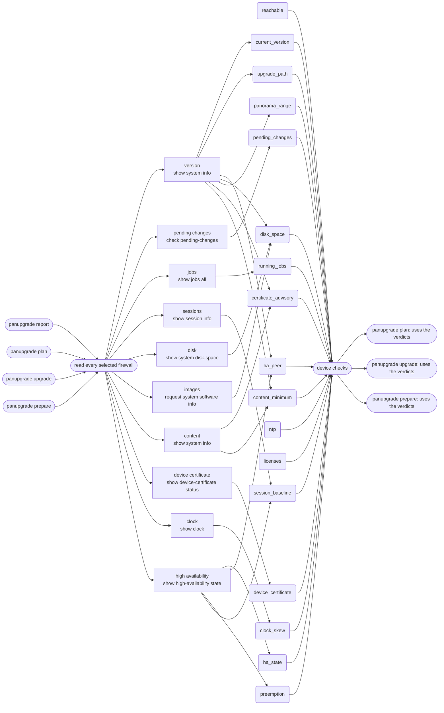

# The checks, and what feeds them

Generated by `tools/flowcharts.py` from the source; do not edit by hand.

## Order the checks run

`run_device_checks` runs `reachable` first; if the firewall cannot be read it stops there. Otherwise every other check runs, in this order, for every firewall in the selection. A **required** check that has no data blocks the firewall, because a collection problem must never look like success.

```mermaid
flowchart LR
    c0[["reachable<br/>(required)"]]
    c1[["current_version<br/>(required)"]]
    c2[["upgrade_path<br/>(required)"]]
    c3[["ha_state<br/>(required)"]]
    c4[["ha_peer<br/>(required)"]]
    c5("preemption")
    c6[["disk_space<br/>(required)"]]
    c7[["pending_changes<br/>(required)"]]
    c8("running_jobs")
    c9("session_baseline<br/><i>The active node's session count is the yardstick for the fai</i>")
    c10("ntp")
    c11("licenses")
    c12("panorama_range<br/><i>Advice only, never a blocker: a firewall far behind Panorama</i>")
    c13("certificate_advisory<br/><i>Is this build (and the target) one that carries the fix for </i>")
    c14("device_certificate<br/><i>The device certificate (`show device-certificate status`). N</i>")
    c15("clock_skew<br/><i>The firewall's clock against Panorama's. A firewall hours of</i>")
    c16("content_minimum<br/><i>PAN-OS refuses to install some releases unless the dynamic c</i>")
    c0 --> c1
    c1 --> c2
    c2 --> c3
    c3 --> c4
    c4 --> c5
    c5 --> c6
    c6 --> c7
    c7 --> c8
    c8 --> c9
    c9 --> c10
    c10 --> c11
    c11 --> c12
    c12 --> c13
    c13 --> c14
    c14 --> c15
    c15 --> c16
```

## Which verbs run them

| verb | reads every selected firewall | runs the device checks |
|---|---|---|
| `select` | no | no |
| `help` | no | no |
| `report` | yes | no |
| `plan` | yes | yes |
| `upgrade` | yes | yes |
| `prepare` | yes | yes |
| `shell` | no | no |
| `auth` | no | no |
| `releases` | no | no |
| `settings` | no | no |

## What each check needs

| check | required | firewall facts it reads | settings it reads | facts nothing collects |
|---|---|---|---|---|
| `reachable` | yes | - | - | - |
| `current_version` | yes | sw_version | allow_downgrade | - |
| `upgrade_path` | yes | sw_version | allow_downgrade | - |
| `ha_state` | yes | ha_mode, ha_state | - | - |
| `ha_peer` | yes | ha_config_sync, ha_links_ok, ha_mode, ha_session_sync, ha_state, sw_version | ha_config_unsynced, sync_to_peer | - |
| `preemption` | no | ha_mode, preemption | - | - |
| `disk_space` | yes | disk_free_mb, images_downloaded, sw_version | allow_downgrade, min_free_disk_mb | - |
| `pending_changes` | yes | pending_changes | pending_changes | - |
| `running_jobs` | no | running_jobs | - | - |
| `session_baseline` | no | ha_mode, ha_state, session_count | - | - |
| `ntp` | no | ntp_synced | - | ntp_synced |
| `licenses` | no | licenses_ok | - | licenses_ok |
| `panorama_range` | no | sw_version | panorama_compare, spread_limit | - |
| `certificate_advisory` | no | content_versions, sw_version | - | - |
| `device_certificate` | no | device_cert | - | - |
| `clock_skew` | no | clock_utc | - | - |
| `content_minimum` | no | content_versions, sw_version | allow_downgrade | - |

A fact in the last column is read by the check but is not set by `collect_facts`, so on a live firewall it is always empty and that check always reports "no data".

## What is read from each firewall

`collect_facts` sends these queries to **every** firewall in the selection, whichever verb is running, one after another. The last column is the checks that use what each one sets.

| step | query sent | sets | used by checks |
|---|---|---|---|
| version | `show system info` | sw_version | certificate_advisory, content_minimum, current_version, disk_space, ha_peer, panorama_range, upgrade_path |
| pending changes | `check pending-changes` | pending_changes | pending_changes |
| jobs | `show jobs all` | running_jobs | running_jobs |
| sessions | `show session info` | session_count | session_baseline |
| disk | `show system disk-space` | disk_free_mb | disk_space |
| images | `request system software info` | images_downloaded, base_images | disk_space |
| content | `show system info` | content_versions | certificate_advisory, content_minimum |
| device certificate | `show device-certificate status` | device_cert | device_certificate |
| clock | `show clock` | clock_utc | clock_skew |
| high availability | `show high-availability state` | ha_mode, ha_state, ha_config_sync, ha_session_sync, ha_links_ok, ha_content_compat, preemption, peer_serial | ha_peer, ha_state, preemption, session_baseline |

Queries sent more than once per firewall:

- `show system info`: version, content

## From the query to the verb

Each query feeds the checks that use what it sets. Every verb marked in the table above sends all of the queries; only the verbs that run the device checks use their results.

