# The upgrade, decision by decision

Generated by `tools/flowcharts.py` from the source; do not edit by hand. Each chart is the function's own `if`/`else`, loops and `try`, drawn as the code is written: **diamonds are decisions** (the condition is the code's own text), boxes are actions (a blue outline is a call on the backend, which is what touches a firewall), a red outline is a refusal (the step fails and the firewall is not touched further), a green outline is a normal end. Assignments that call nothing are left out. Function names carry their file and line so the code can be read beside the chart.

How it fits together: `plan` gives every firewall a list of steps (section 1). `upgrade` runs each unit, an HA pair or a standalone firewall, in the order the plan gave (section 2); units run in parallel up to `max_parallel`, the members of a pair one after the other, passive first. Each step of the list is carried out by `_do` (section 3), one chart per step.

## 1. Which steps a firewall is given

`planner._steps` ([planner.py:299]). The same function, run for a model firewall of each kind with default settings (`TARGET` is a version, `CURRENT` the one it runs now):

- **standalone**: `download TARGET` → `backup` → `install TARGET` → `reboot` → `verify`
- **HA passive (its active peer is in the run)**: `download TARGET` → `backup` → `install TARGET` → `reboot` → `verify` → `verify HA`
- **HA active, passive peer in the run**: `download TARGET` → `backup` → `wait for the passive firewall's upgrade to finish` → `fail over` → `install TARGET` → `reboot` → `verify` → `go live` → `verify HA`
- **HA active, peer not in the run**: `download TARGET` → `backup` → `fail over` → `install TARGET` → `reboot` → `verify` → `go live` → `verify HA`
- **HA active, preemption on, peer in the run**: `download TARGET` → `backup` → `wait for the passive firewall's upgrade to finish` → `fail over` → `hold suspended` → `install TARGET` → `reboot` → `verify` → `go live` → `verify HA`

```mermaid
flowchart TD
    s1(["planner._steps"])
    s2["role = 'standalone' if dev['ha_mode'] == 'none' else dev['ha_state']"]
    s3["hold = bool(dev['preemption']) and role != 'standalone'"]
    s4["syncing = any((r.get('ack') == 'force_config_sync' for r in dev['results']))"]
    s5["peer_planned = bool(devices and dev['peer_serial'] in devices and (devices[dev['pee…"]
    s6{"for p in _path_steps(dev)"}
    s7{"p['download']"}
    s8["step: f'download {p['version']}'"]
    s9["step: 'backup'"]
    s10{"syncing and (role == 'passive' or not peer_planned)"}
    s11["step: 'sync to peer'"]
    s12{"role == 'active' and peer_planned"}
    s13["peer = devices[dev['peer_serial']]['hostname']"]
    s14["step: 'wait for the passive firewall's upgrade to finish'"]
    s15{"role == 'active'"}
    s16["takes_over = 'its already upgraded passive peer takes over' if peer_planned else 'i…"]
    s17["step: 'fail over'"]
    s18{"hold"}
    s19["step: 'hold suspended'"]
    s20["installs = [p for p in _path_steps(dev) if p['install']]"]
    s21{"for p in installs"}
    s22["step: f'install {p['version']}'"]
    s23["step: 'reboot'"]
    s24["step: 'verify'"]
    s25{"hold or role == 'active'"}
    s26["step: 'go live'"]
    s27{"role != 'standalone'"}
    s28["step: 'verify HA'"]
    s29{"role != 'standalone' and settings.restore_roles == 'restore' and (role == 'active')"}
    s30["step: 'restore roles'"]
    s31(["return (steps, rollback)"])
    s1 --> s2
    s2 --> s3
    s3 --> s4
    s4 --> s5
    s5 --> s6
    s6 -->|each| s7
    s7 -->|yes| s8
    s8 --> s6
    s7 -->|no| s6
    s6 -->|done| s9
    s9 --> s10
    s10 -->|yes| s11
    s11 --> s12
    s10 -->|no| s12
    s12 -->|yes| s13
    s13 --> s14
    s14 --> s15
    s12 -->|no| s15
    s15 -->|yes| s16
    s16 --> s17
    s17 --> s18
    s15 -->|no| s18
    s18 -->|yes| s19
    s19 --> s20
    s18 -->|no| s20
    s20 --> s21
    s21 -->|each| s22
    s22 --> s23
    s23 --> s24
    s24 --> s21
    s21 -->|done| s25
    s25 -->|yes| s26
    s26 --> s27
    s25 -->|no| s27
    s27 -->|yes| s28
    s28 --> s29
    s27 -->|no| s29
    s29 -->|yes| s30
    s30 --> s31
    s29 -->|no| s31
    classDef api stroke:#2f6fed,stroke-width:3px
    classDef refuse stroke:#d64545,stroke-width:3px
    classDef done stroke:#2e9e5b,stroke-width:3px
    classDef step stroke:#e0a020,stroke-width:3px
    classDef entry stroke-width:3px
    class s1 entry
    class s8 step
    class s9 step
    class s11 step
    class s14 step
    class s17 step
    class s19 step
    class s22 step
    class s23 step
    class s24 step
    class s26 step
    class s28 step
    class s30 step
    class s31 done
```

## 2. How a unit and a firewall are run

`executor.run`, for each unit ([executor.py:59]). A member is run only when the one before it in the unit finished; a firewall that failed earlier in the journal is not retried.

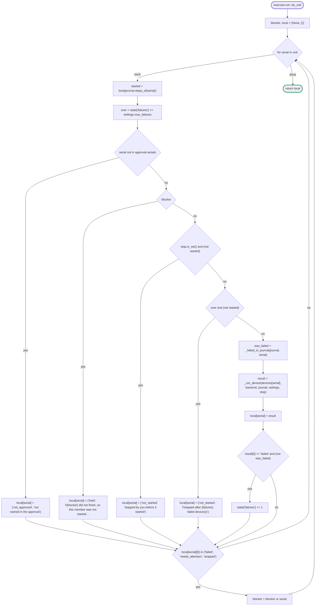

`executor._run_device` ([executor.py:124]): preflight, then each step in order. A step already marked done in the journal is skipped, and one that was started and never finished is never repeated: it needs a person to look at the firewall.

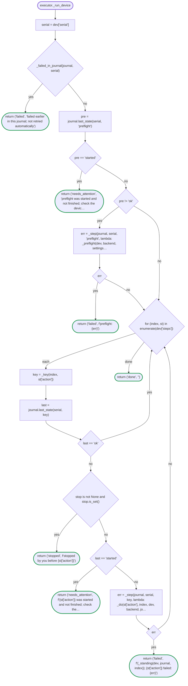

`executor._preflight` ([executor.py:191]): the plan is checked against the firewall again just before it is touched.

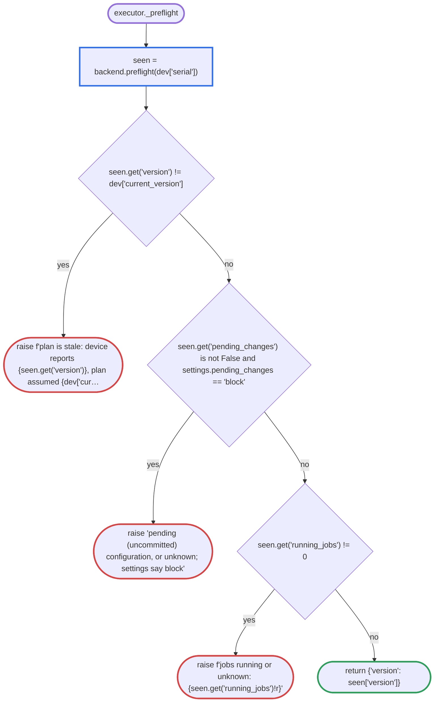

`executor._step` ([executor.py:180]) wraps every step: write `started`, run it, write `ok` or `failed`.

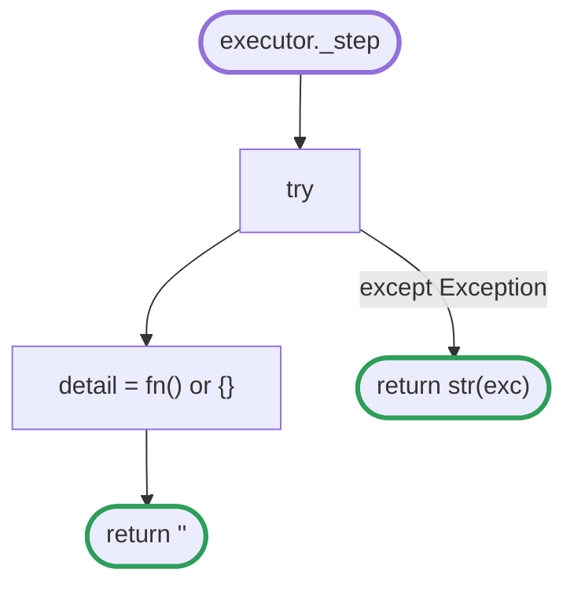

## 3. How each step is carried out

`executor._do` ([executor.py:229]). Before any step that installs or reboots, a verified backup must be in the journal:

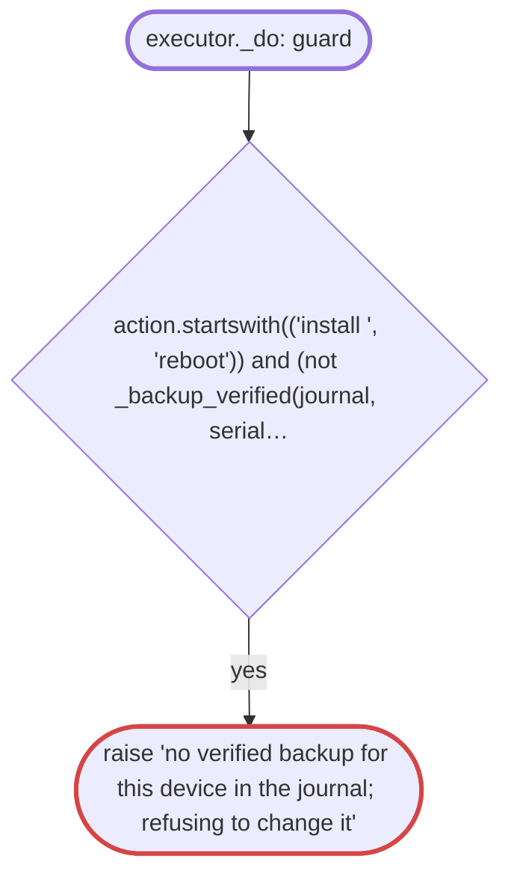

### starts with 'download '

executor.py:233

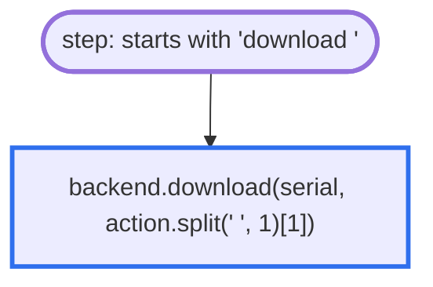

### 'backup'

executor.py:235

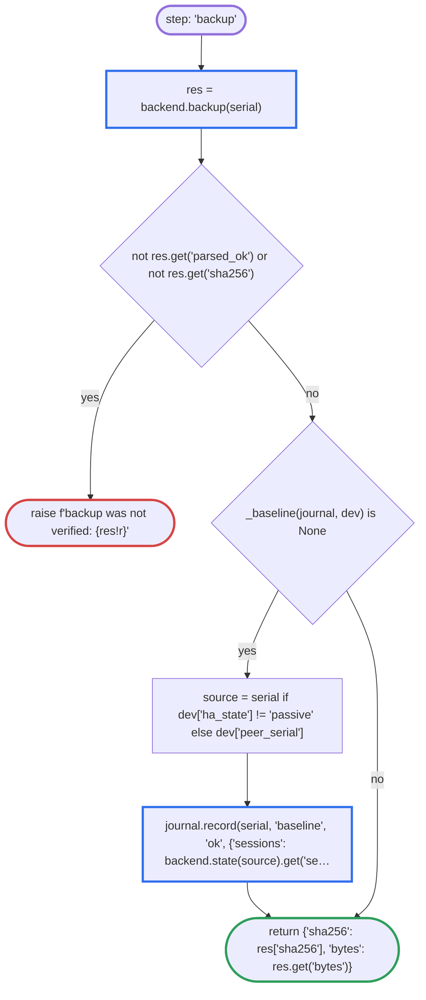

### 'sync to peer'

executor.py:243

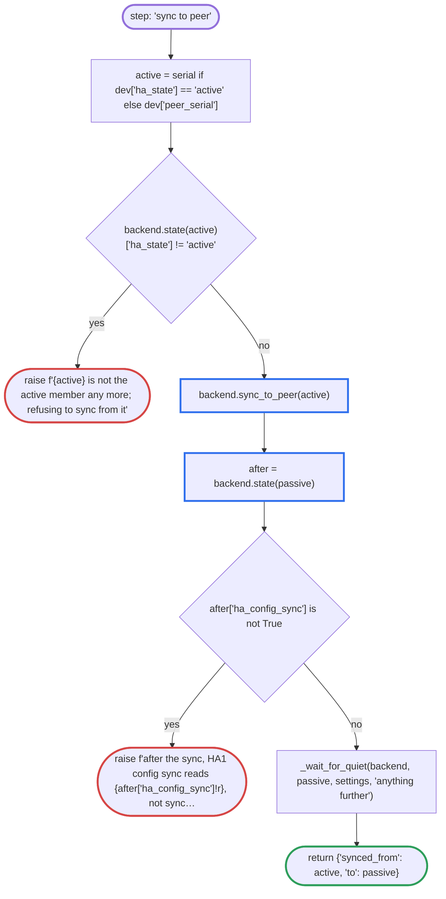

### "wait for the passive firewall's upgrade to finish"

executor.py:254

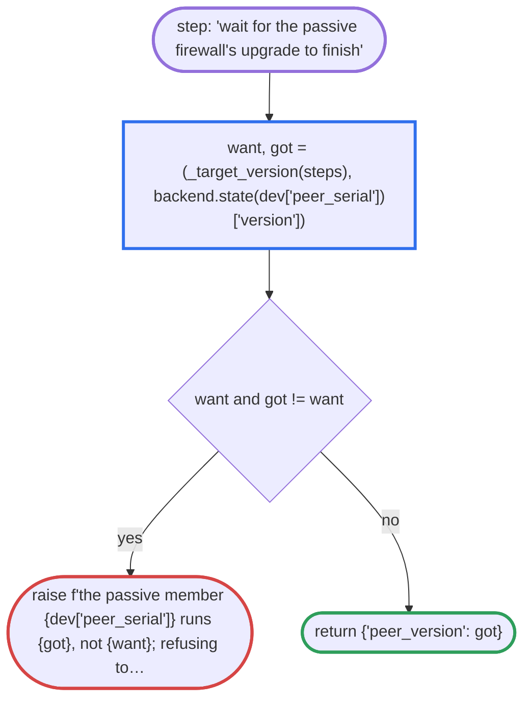

### 'fail over'

executor.py:261

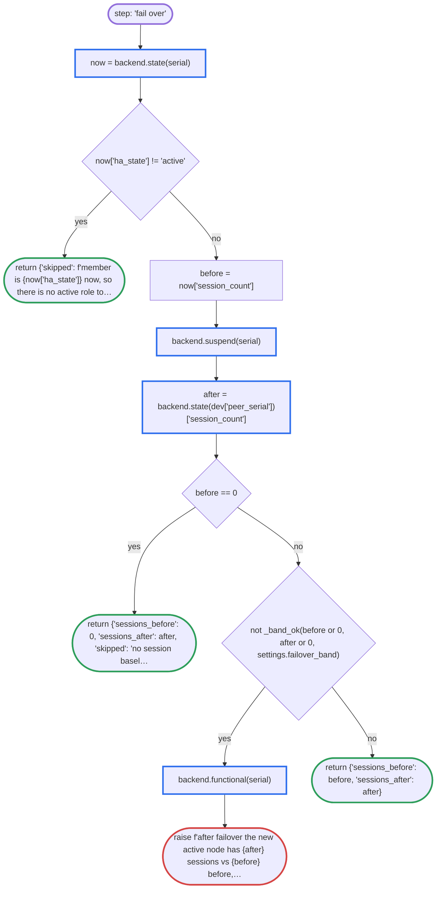

### 'hold suspended'

executor.py:275

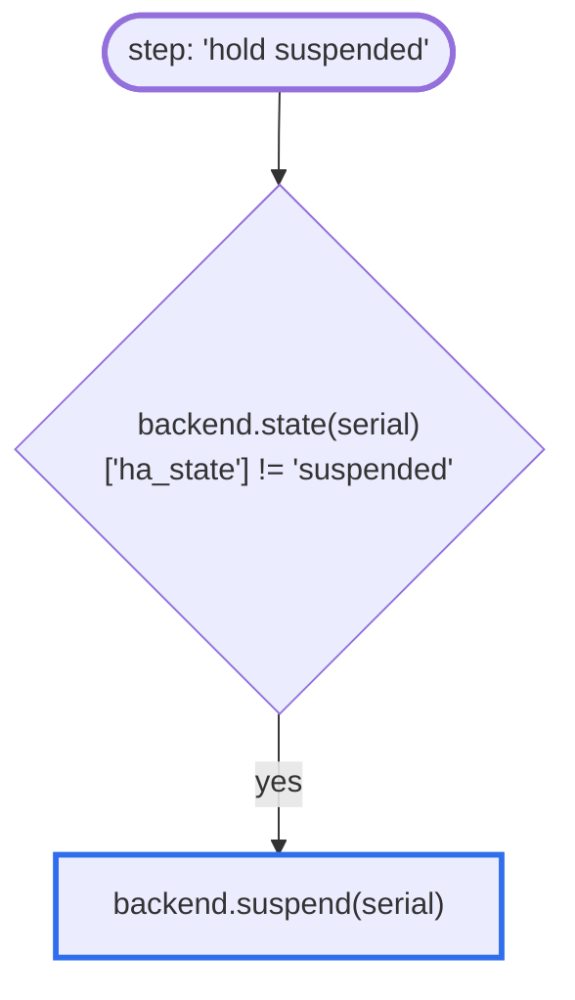

### starts with 'install '

executor.py:278

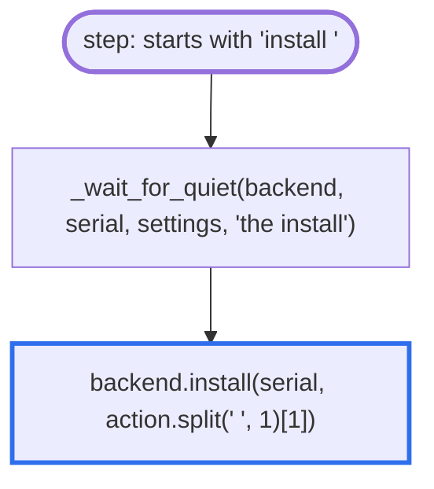

### 'reboot'

executor.py:281

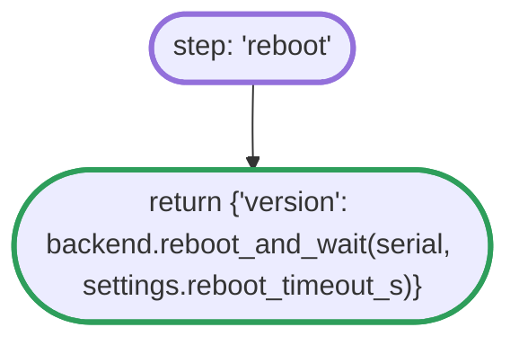

### 'verify'

executor.py:283

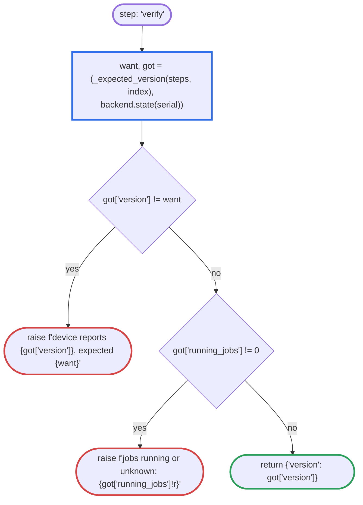

### 'go live'

executor.py:290

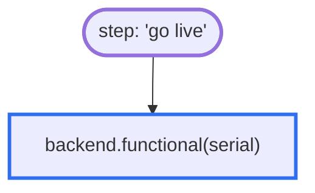

### 'verify HA'

executor.py:292

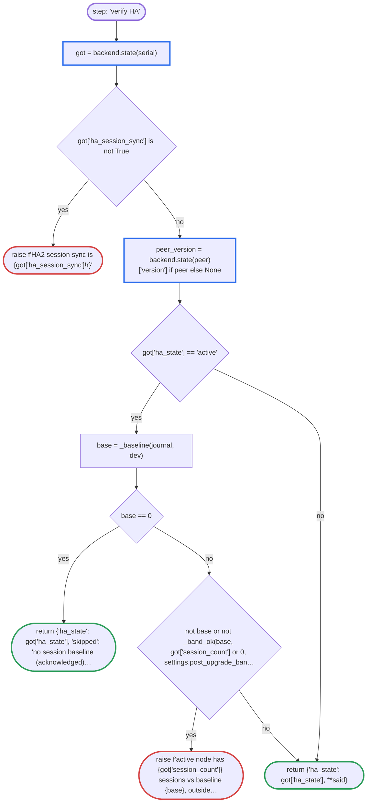

### 'restore roles'

executor.py:309

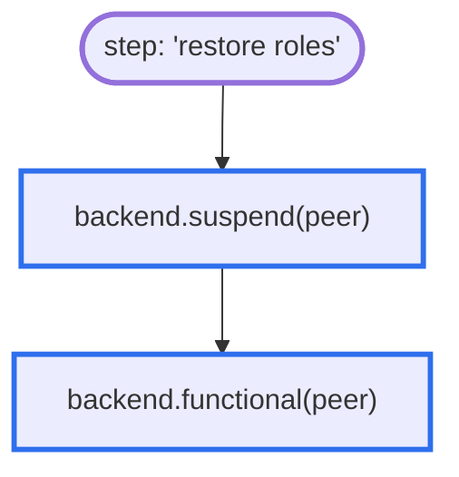

### anything else

executor.py:314

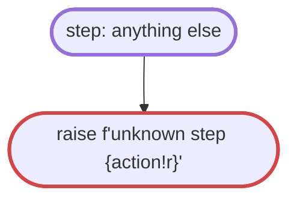

## Where the code decides about HA synchronisation and the session count

Found by reading every decision in the code that looks at the config-sync or session-sync state, the session count, or the two bands. The last column is the verbs that reach the function (by name; calls through callbacks are not seen). Earlier rows decide before anything is touched; the `executor` rows decide during the upgrade.

| module | function (line) | the condition, as written | verbs |
|---|---|---|---|
| checks | `ha_peer` (checks.py:152) | `problems == ['HA1 config sync'] and f.ha_session_sync and (f.ha_links_ok is not False)` | plan, upgrade, prepare |
| prepare | `build` (prepare.py:143) | `facts.ha_config_sync is False` | prepare |
| executor | `_do` (executor.py:250) | `after['ha_config_sync'] is not True` | upgrade |
| executor | `_do` (executor.py:270) | `not _band_ok(before or 0, after or 0, settings.failover_band)` | upgrade |
| executor | `_do` (executor.py:294) | `got['ha_session_sync'] is not True` | upgrade |
| executor | `_do` (executor.py:305) | `not base or not _band_ok(base, got['session_count'] or 0, settings.post_upgrade_band)` | upgrade |
| fleetreport | `_attention` (fleetreport.py:47) | `facts.get('ha_config_sync') is False and (not mixed)` | report |

## Helpers the charts call

| function | what it does |
|---|---|
| `_backup_verified` (executor.py:202) | return any((st['action'] == 'backup' and journal.last_state(serial, _key(i, 'backup')) == 'ok' for i, st in enumerate(steps))) |
| `_band_ok` (executor.py:55) | return before > 0 and abs(after - before) / before <= band |
| `_baseline` (executor.py:220) | The pair's session baseline: the count on the node that was active before the unit started. |
| `_expected_version` (executor.py:212) | see the source |
| `_failed_in_journal` (executor.py:116) | return any((e['state'] == 'failed' for e in journal.steps_of(serial))) |
| `_key` (executor.py:120) | return f'{index}:{action}' |
| `_standing` (executor.py:150) | Where a firewall stands when the step at ``index`` did not finish: which version it is on matters more than which step it was. |
| `_target_version` (executor.py:207) | return _expected_version(steps, len(steps)) |
| `_wait_for_quiet` (executor.py:167) | A config sync queues a commit on the member it pushes to, and the install is refused while that is still in the queue |

## Settings the charts read

| setting | default |
|---|---|
| `failover_band` | `0.3` |
| `image_source` | `'firewall'` |
| `install_timeout_s` | `3600` |
| `max_failures` | `5` |
| `pending_changes` | `'block'` |
| `post_upgrade_band` | `0.5` |
| `reboot_timeout_s` | `1920` |
| `restore_roles` | `'leave'` |

## What each backend call does on a live firewall

From `LiveBackend` ([backend.py](../../src/panupgrade_live/backend.py)). The simulator (`SimBackend`) models the same calls without sending anything. Commands are Panorama API operations, run against the firewall.

| call | sends | then waits |
|---|---|---|
| `backend.preflight` | `the firewall's state (the queries listed in checks.md)` | - |
| `backend.download` | `<request><system><software><check/></software></system></request>` `<request><system><software><info/></software></system></request>` `f'<request><system><software><{verb}><version>{version}</version></{verb}></software></system></request>'` | up to download_timeout_s (3600 s by default) for the job: f'download {version}' |
| `backend.backup` | `<show><config><running/></config></show>` | - |
| `backend.state` | `the firewall's state (the queries listed in checks.md)` | - |
| `backend.sync_to_peer` | `<request><high-availability><sync-to-remote><running-config/></sync-to-remote></high-availability></request>` | up to sync_timeout_s (600 s by default) for the HA config sync reading synchronized |
| `backend.suspend` | `<request><high-availability><state><suspend/></state></high-availability></request>` | up to 120 s for the member reading suspended |
| `backend.functional` | `<request><high-availability><state><functional/></state></high-availability></request>` | up to 300 s for the member leaving the suspended state |
| `backend.install` | `f'<request><system><software><{verb}><version>{version}</version></{verb}></software></system></request>'` | up to install_timeout_s (3600 s by default) for the job: f'install {version}' |
| `backend.reboot_and_wait` | `<request><restart><system/></restart></request>` | up to timeout_s given by the caller for the firewall coming back from its reboot up to 900 s for boot-time jobs (auto-commit) finishing |
