# The upgrade, decision by decision

Generated by `tools/flowcharts.py` from the source; do not edit by hand. Each chart is the function's own `if`/`else`, loops and `try`, drawn as the code is written: **diamonds are decisions** (the condition is the code's own text), boxes are actions (a blue outline is a call on the backend, which is what touches a firewall), a red outline is a refusal (the step fails and the firewall is not touched further), a green outline is a normal end. Assignments that call nothing are left out. Function names carry their file and line so the code can be read beside the chart.

How it fits together: `plan` gives every firewall a list of steps (section 1). `upgrade` runs each unit, an HA pair or a standalone firewall, in the order the plan gave (section 2); units run in parallel up to `max_parallel`, the members of a pair one after the other, passive first. Each step of the list is carried out by `_do` (section 3), one chart per step.

## 1. Which steps a firewall is given

`planner._steps` ([planner.py:490]). The same function, run for a model firewall of each kind with default settings (`TARGET` is a version, `CURRENT` the one it runs now):

- **standalone**: `download TARGET` → `backup` → `install TARGET` → `reboot` → `verify`
- **HA passive (its active peer is in the run)**: `download TARGET` → `backup` → `install TARGET` → `reboot` → `verify` → `verify HA`
- **HA active, passive peer in the run**: `download TARGET` → `backup` → `wait for the passive firewall's upgrade to finish` → `fail over` → `install TARGET` → `reboot` → `verify` → `go live` → `verify HA`
- **HA active, peer not in the run**: `download TARGET` → `backup` → `fail over` → `install TARGET` → `reboot` → `verify` → `go live` → `verify HA`
- **HA active, preemption on, peer in the run**: `download TARGET` → `backup` → `wait for the passive firewall's upgrade to finish` → `fail over` → `hold suspended` → `install TARGET` → `reboot` → `verify` → `go live` → `verify HA`

```mermaid
flowchart TD
    s1(["planner._steps"])
    s2["role = 'standalone' if dev['ha_mode'] == 'none' else dev['ha_state']"]
    s3["hold = bool(dev['preemption']) and role != 'standalone'"]
    s4["syncing = any((r.get('ack') == 'force_config_sync' for r in dev['results']))"]
    s5["peer_planned = bool(devices and dev['peer_serial'] in devices and (devices[dev['pee…"]
    s6{"for p in _path_steps(dev)"}
    s7{"p['download']"}
    s8["step: f'download {p['version']}'"]
    s9["step: 'backup'"]
    s10["pos = dev.get('position')"]
    s11["active_first = settings.upgrade_first == 'active' and bool(pos)"]
    s12["swaps = role == 'active' or (active_first and pos == 'second')"]
    s13{"syncing and (pos == 'first' or (pos is None and (role == 'passive' or not peer_plan…"}
    s14["step: 'sync to peer'"]
    s15{"pos == 'second' or (pos is None and role == 'active' and peer_planned)"}
    s16["peer = devices[dev['peer_serial']]['hostname']"]
    s17{"active_first"}
    s18["step: WAIT_FIRST"]
    s19["step: WAIT_PASSIVE"]
    s20{"swaps"}
    s21{"active_first and pos == 'first'"}
    s22["takes_over = 'its passive peer takes over, which proves that member's cabling and t…"]
    s23["takes_over = 'its already upgraded ' + ('peer' if active_first else 'passive peer')…"]
    s24["step: 'fail over'"]
    s25{"hold"}
    s26["step: 'hold suspended'"]
    s27["installs = [p for p in _path_steps(dev) if p['install']]"]
    s28["drains = bool(dev.get('group')) and bool(settings.lb_drain_profile)"]
    s29["drained = False"]
    s30["activate = dev.get('activate')"]
    s31{"activate"}
    s32["step: f'reboot to activate {activate['version']}'"]
    s33["step: 'verify'"]
    s34{"for p in installs"}
    s35["drain_once()"]
    s36["step: f'install {p['version']}'"]
    s37["step: 'reboot'"]
    s38["step: 'verify'"]
    s39{"drained"}
    s40["step: 'undrain'"]
    s41{"dev.get('group')"}
    s42["step: 'check service'"]
    s43{"hold or swaps"}
    s44["step: 'go live'"]
    s45{"role != 'standalone'"}
    s46["step: 'verify HA'"]
    s47{"role != 'standalone' and settings.restore_roles == 'restore' and (role == 'active')…"}
    s48["step: 'restore roles'"]
    s49(["return (steps, rollback)"])
    s1 --> s2
    s2 --> s3
    s3 --> s4
    s4 --> s5
    s5 --> s6
    s6 -->|each| s7
    s7 -->|yes| s8
    s8 --> s6
    s7 -->|no| s6
    s6 -->|done| s9
    s9 --> s10
    s10 --> s11
    s11 --> s12
    s12 --> s13
    s13 -->|yes| s14
    s14 --> s15
    s13 -->|no| s15
    s15 -->|yes| s16
    s16 --> s17
    s17 -->|yes| s18
    s17 -->|no| s19
    s18 --> s20
    s19 --> s20
    s15 -->|no| s20
    s20 -->|yes| s21
    s21 -->|yes| s22
    s21 -->|no| s23
    s22 --> s24
    s23 --> s24
    s24 --> s25
    s20 -->|no| s25
    s25 -->|yes| s26
    s26 --> s27
    s25 -->|no| s27
    s27 --> s28
    s28 --> s29
    s29 --> s30
    s30 --> s31
    s31 -->|yes| s32
    s32 --> s33
    s33 --> s34
    s31 -->|no| s34
    s34 -->|each| s35
    s35 --> s36
    s36 --> s37
    s37 --> s38
    s38 --> s34
    s34 -->|done| s39
    s39 -->|yes| s40
    s40 --> s41
    s39 -->|no| s41
    s41 -->|yes| s42
    s42 --> s43
    s41 -->|no| s43
    s43 -->|yes| s44
    s44 --> s45
    s43 -->|no| s45
    s45 -->|yes| s46
    s46 --> s47
    s45 -->|no| s47
    s47 -->|yes| s48
    s48 --> s49
    s47 -->|no| s49
    classDef api stroke:#2f6fed,stroke-width:3px
    classDef refuse stroke:#d64545,stroke-width:3px
    classDef done stroke:#2e9e5b,stroke-width:3px
    classDef step stroke:#e0a020,stroke-width:3px
    classDef entry stroke-width:3px
    class s1 entry
    class s8 step
    class s9 step
    class s14 step
    class s18 step
    class s19 step
    class s24 step
    class s26 step
    class s32 step
    class s33 step
    class s36 step
    class s37 step
    class s38 step
    class s40 step
    class s42 step
    class s44 step
    class s46 step
    class s48 step
    class s49 done
```

## 2. How a unit and a firewall are run

`executor.run`, for each unit ([executor.py:83]). A member is run only when the one before it in the unit finished; a firewall that failed earlier in the journal is not retried.

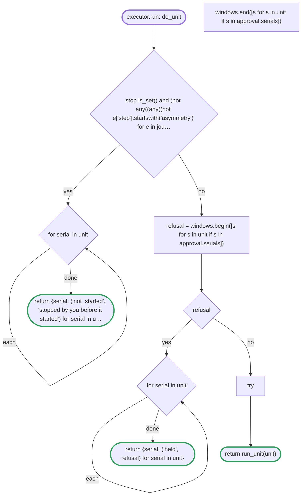

`executor._run_device` ([executor.py:171]): preflight, then each step in order. A step already marked done in the journal is skipped, and one that was started and never finished is never repeated: it needs a person to look at the firewall.

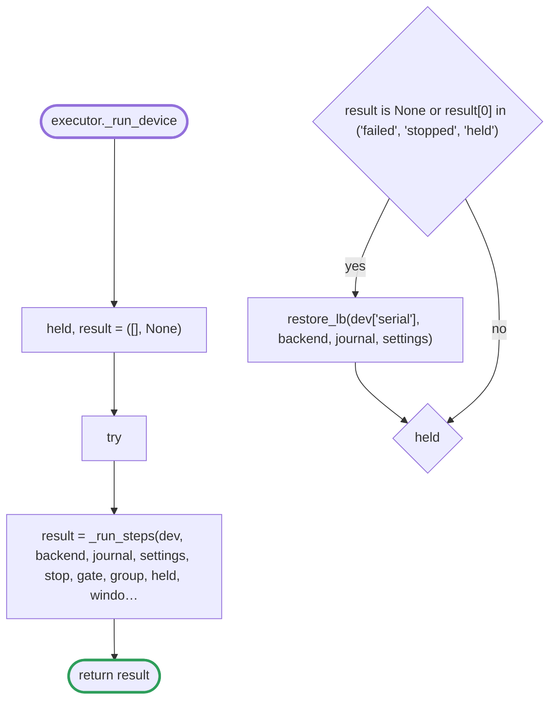

`executor._preflight` ([executor.py:337]): the plan is checked against the firewall again just before it is touched.

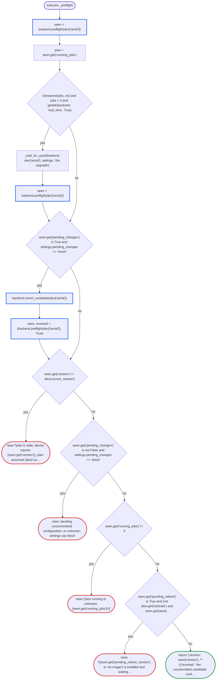

`executor._step` ([executor.py:326]) wraps every step: write `started`, run it, write `ok` or `failed`.

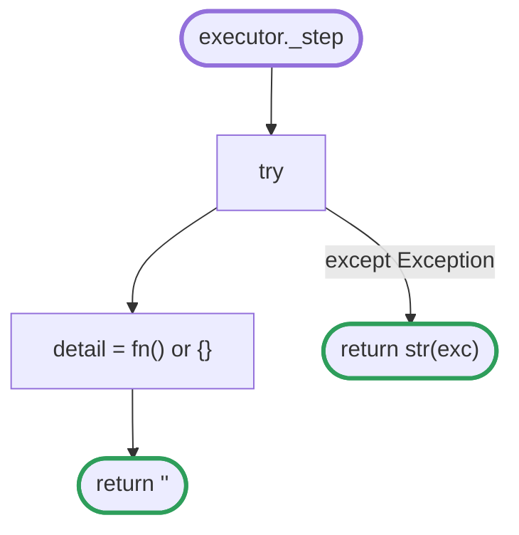

## 3. How each step is carried out

`executor._do` ([executor.py:547]). Before any step that installs or reboots, a verified backup must be in the journal:

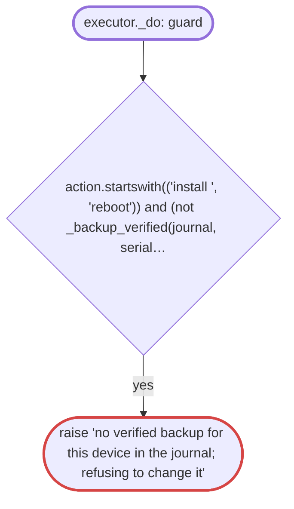

### starts with 'download '

executor.py:551

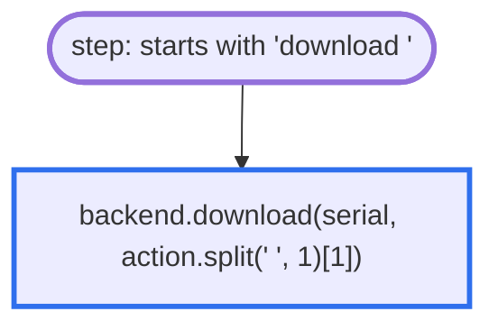

### 'backup'

executor.py:553

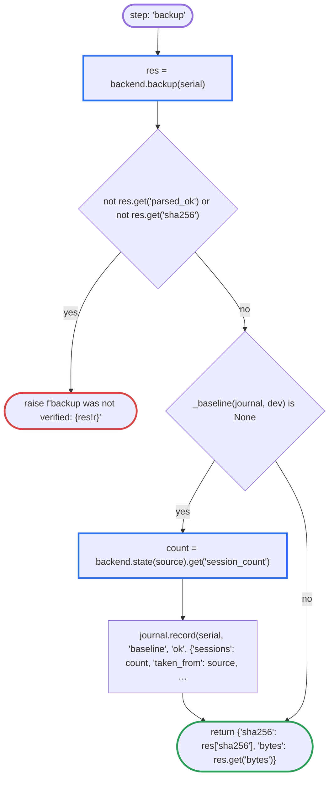

### 'sync to peer'

executor.py:563

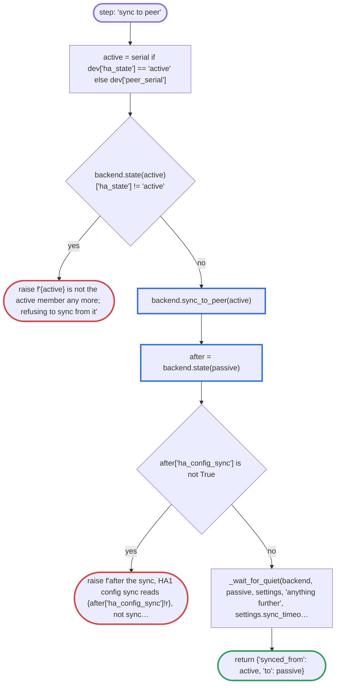

### "wait for the passive firewall's upgrade to finish" or "wait for the first member's upgrade to finish"

executor.py:574

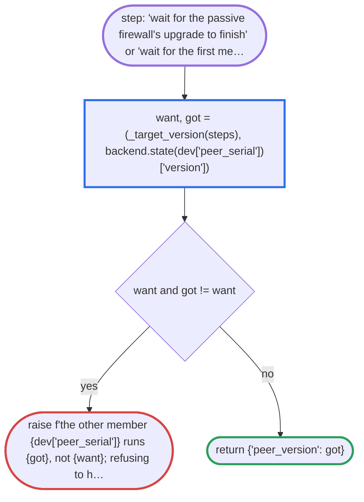

### 'fail over'

executor.py:581

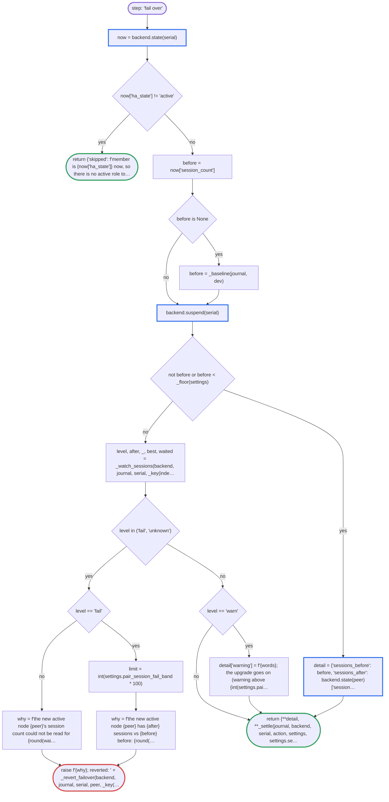

### 'hold suspended'

executor.py:619

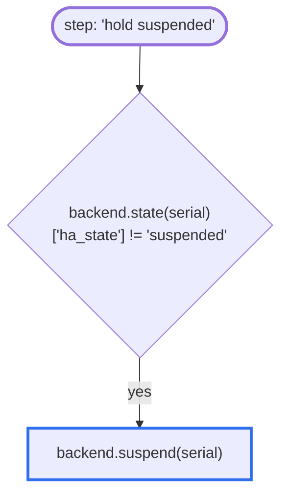

### starts with 'install '

executor.py:622

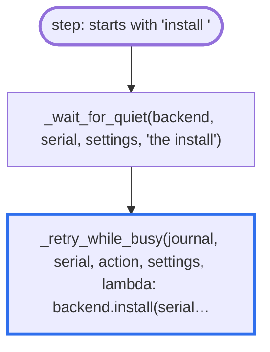

### 'drain'

executor.py:625

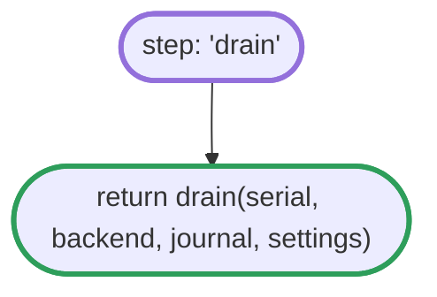

### 'undrain'

executor.py:628

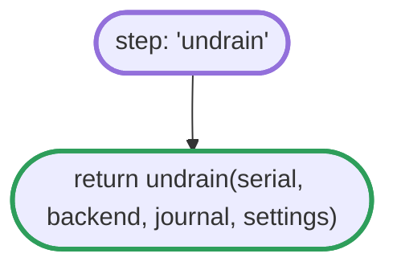

### 'check service'

executor.py:631

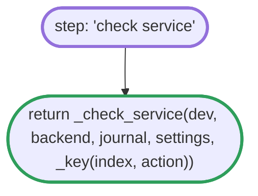

### 'reboot' or starts with 'reboot to activate '

executor.py:633

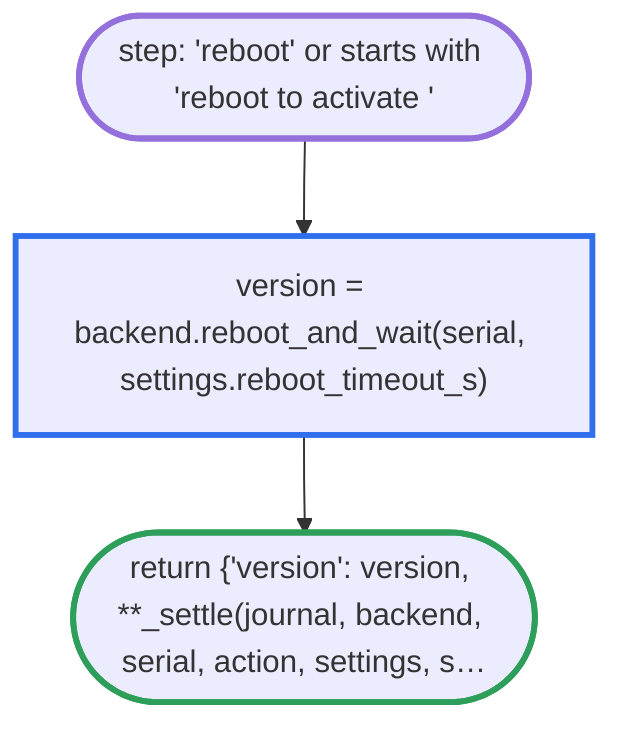

### 'verify'

executor.py:637

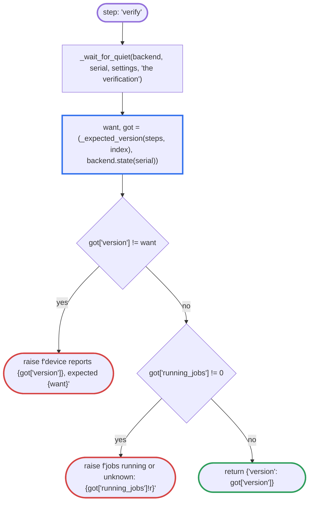

### 'go live'

executor.py:645

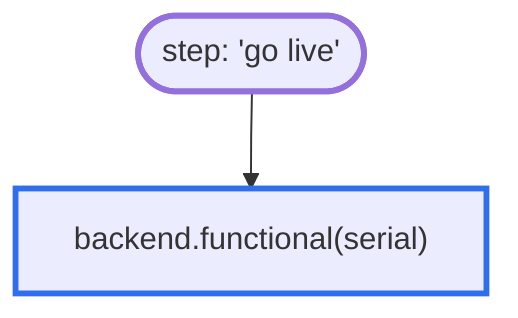

### 'verify HA'

executor.py:647

```mermaid
flowchart TD
    d14_1(["step: 'verify HA'"])
    d14_2["got = backend.state(serial)"]
    d14_3{"got['ha_state'] == 'suspended' and dev['ha_state'] == 'suspended'"}
    d14_4(["raise 'the member was suspended when planned and is still suspended after the upgra…"])
    d14_5{"got['ha_session_sync'] is not True"}
    d14_6(["raise f'HA2 session sync is {got['ha_session_sync']!r}'"])
    d14_7["peer = dev.get('peer_serial')"]
    d14_8["peer_version = backend.state(peer)['version'] if peer else None"]
    d14_9{"got['ha_state'] == 'active'"}
    d14_10["base = _baseline(journal, dev)"]
    d14_11{"base is not None and base &lt; _floor(settings)"}
    d14_12(["return {'ha_state': got['ha_state'], 'skipped': 'no session baseline (acknowledged)…"])
    d14_13{"not base"}
    d14_14(["raise f'active node has {got['session_count']} sessions and there is no baseline to…"])
    d14_15["level, count, _, best, waited = _watch_sessions(backend, journal, serial, _key(inde…"]
    d14_16{"level == 'unknown'"}
    d14_17(["raise f'the active node's session count could not be read for {round(waited)}s' + (…"])
    d14_18{"level == 'fail'"}
    d14_19(["raise f'{words} (failure at {int(settings.pair_session_fail_band * 100)}% or more s…"])
    d14_20{"level == 'warn'"}
    d14_21["said['warning'] = f'{words} (warning above {int(settings.pair_session_warn_band * 1…"]
    d14_22{"dev.get('position') == 'second' and peer"}
    d14_23["theirs = backend.state(peer)"]
    d14_24["base = _baseline(journal, dev)"]
    d14_25{"theirs['ha_state'] == 'active' and base is not None and (base &lt; _floor(settings))"}
    d14_26["said['warning'] = f'the pair's baseline is {base} sessions, below the noise floor o…"]
    d14_27{"theirs['ha_state'] == 'active' and base and (base &gt;= _floor(settings))"}
    d14_28["errors = []"]
    d14_29["level, count, _, best, waited = _watch_sessions(backend, journal, serial, _key(inde…"]
    d14_30{"level == 'unknown'"}
    d14_31(["raise f'the pair is upgraded but the active node {peer}'s session count could not b…"])
    d14_32["words = f'the pair is upgraded but the active node {peer} has {count} sessions vs b…"]
    d14_33{"level == 'fail'"}
    d14_34(["raise f'{words} (failure at {int(settings.pair_session_fail_band * 100)}% or more s…"])
    d14_35{"level == 'warn'"}
    d14_36["said['warning'] = f'{words} (warning above {int(settings.pair_session_warn_band * 1…"]
    d14_37["said['active_sessions'] = count"]
    d14_38(["return {'ha_state': got['ha_state'], **said}"])
    d14_1 --> d14_2
    d14_2 --> d14_3
    d14_3 -->|yes| d14_4
    d14_3 -->|no| d14_5
    d14_5 -->|yes| d14_6
    d14_5 -->|no| d14_7
    d14_7 --> d14_8
    d14_8 --> d14_9
    d14_9 -->|yes| d14_10
    d14_10 --> d14_11
    d14_11 -->|yes| d14_12
    d14_11 -->|no| d14_13
    d14_13 -->|yes| d14_14
    d14_13 -->|no| d14_15
    d14_15 --> d14_16
    d14_16 -->|yes| d14_17
    d14_16 -->|no| d14_18
    d14_18 -->|yes| d14_19
    d14_18 -->|no| d14_20
    d14_20 -->|yes| d14_21
    d14_9 -->|no| d14_22
    d14_22 -->|yes| d14_23
    d14_23 --> d14_24
    d14_24 --> d14_25
    d14_25 -->|yes| d14_26
    d14_26 --> d14_27
    d14_25 -->|no| d14_27
    d14_27 -->|yes| d14_28
    d14_28 --> d14_29
    d14_29 --> d14_30
    d14_30 -->|yes| d14_31
    d14_30 -->|no| d14_32
    d14_32 --> d14_33
    d14_33 -->|yes| d14_34
    d14_33 -->|no| d14_35
    d14_35 -->|yes| d14_36
    d14_36 --> d14_37
    d14_35 -->|no| d14_37
    d14_21 --> d14_38
    d14_20 -->|no| d14_38
    d14_37 --> d14_38
    d14_27 -->|no| d14_38
    d14_22 -->|no| d14_38
    classDef api stroke:#2f6fed,stroke-width:3px
    classDef refuse stroke:#d64545,stroke-width:3px
    classDef done stroke:#2e9e5b,stroke-width:3px
    classDef step stroke:#e0a020,stroke-width:3px
    classDef entry stroke-width:3px
    class d14_1 entry
    class d14_2 api
    class d14_4 refuse
    class d14_6 refuse
    class d14_8 api
    class d14_12 done
    class d14_14 refuse
    class d14_17 refuse
    class d14_19 refuse
    class d14_23 api
    class d14_31 refuse
    class d14_34 refuse
    class d14_38 done
```

### 'restore roles'

executor.py:698

```mermaid
flowchart TD
    d15_1(["step: 'restore roles'"])
    d15_2["backend.suspend(peer)"]
    d15_3["backend.functional(peer)"]
    d15_1 --> d15_2
    d15_2 --> d15_3
    classDef api stroke:#2f6fed,stroke-width:3px
    classDef refuse stroke:#d64545,stroke-width:3px
    classDef done stroke:#2e9e5b,stroke-width:3px
    classDef step stroke:#e0a020,stroke-width:3px
    classDef entry stroke-width:3px
    class d15_1 entry
    class d15_2 api
    class d15_3 api
```

### anything else

executor.py:703

```mermaid
flowchart TD
    d16_1(["step: anything else"])
    d16_2(["raise f'unknown step {action!r}'"])
    d16_1 --> d16_2
    classDef api stroke:#2f6fed,stroke-width:3px
    classDef refuse stroke:#d64545,stroke-width:3px
    classDef done stroke:#2e9e5b,stroke-width:3px
    classDef step stroke:#e0a020,stroke-width:3px
    classDef entry stroke-width:3px
    class d16_1 entry
    class d16_2 refuse
```

## Where the code decides about HA synchronisation and the session count

Found by reading every decision in the code that looks at the config-sync or session-sync state, the session count, or the two bands. The last column is the verbs that reach the function (by name; calls through callbacks are not seen). Earlier rows decide before anything is touched; the `executor` rows decide during the upgrade.

| module | function (line) | the condition, as written | verbs |
|---|---|---|---|
| checks | `ha_peer` (checks.py:169) | `problems == ['HA1 config sync'] and f.ha_session_sync and (f.ha_links_ok is not False)` | plan, upgrade, prepare |
| planner | `_apply_plugins` (planner.py:367) | `f is None or f.ha_mode != 'active-passive' or f.ha_state != 'active' or (f.ha_config_sync is not False) or (devices.get…` | plan, upgrade, prepare |
| prepare | `build` (prepare.py:146) | `steps and idle and (not (facts.session_count or 0) >= floor)` | prepare |
| prepare | `build` (prepare.py:148) | `facts.session_count is None` | prepare |
| prepare | `build` (prepare.py:189) | `facts.ha_config_sync is False` | prepare |
| executor | `_sessions` (executor.py:505) | `hasattr(backend, 'session_count')` | upgrade |
| executor | `_do` (executor.py:570) | `after['ha_config_sync'] is not True` | upgrade |
| executor | `_do` (executor.py:652) | `got['ha_session_sync'] is not True` | upgrade |
| fleetreport | `_attention` (fleetreport.py:49) | `facts.get('ha_config_sync') is False and (not mixed)` | report |

## Helpers the charts call

| function | what it does |
|---|---|
| `_backup_verified` (executor.py:359) | return any((st['action'] == 'backup' and journal.last_state(serial, _key(i, 'backup')) == 'ok' for i, st in enumerate(steps))) |
| `_baseline` (executor.py:377) | The pair's session baseline: the count on the node that was active before the unit started. |
| `_check_service` (executor.py:512) | A group member is back (upgraded, undrained): wait until its session table is within ``group_session_warn_band`` of what it was before it |
| `_expected_version` (executor.py:369) | see the source |
| `_floor` (executor.py:497) | return max(settings.session_noise_floor, 1) |
| `_key` (executor.py:167) | return f'{index}:{action}' |
| `_retry_while_busy` (executor.py:308) | Run a command the firewall may refuse because it is busy. The jobs list showed nothing a moment ago, but a commit can be queued |
| `_revert_failover` (executor.py:447) | Put the traffic back where it was known to work: this member (the active one before the fail-over) active again, the peer out of the way. |
| `_run_steps` (executor.py:187) | see the source |
| `_sessions` (executor.py:502) | try: return backend.session_count(serial) if hasattr(backend, 'session_count') else backend.state(serial).get('session_count') except Exception as ex… |
| `_settle` (executor.py:271) | Wait ``seconds``, then until the firewall has no unfinished job, before the next step touches it. |
| `_target_version` (executor.py:364) | return _expected_version(steps, len(steps)) |
| `_versions_note` (executor.py:488) | What the pair is left running, for a failure that cannot be undone: 'A runs x, B runs y'. Empty when it cannot be read. |
| `_wait_for_quiet` (executor.py:293) | A config sync, an HA state change or a boot queues a commit on the firewall, and the install is refused while that is still in the |
| `_watch_sessions` (executor.py:386) | Wait until a node's session table is back, and judge it. ``observe()`` gives (the node's count, [the counts it should match]); the best of |

## Settings the charts read

| setting | default |
|---|---|
| `group_session_fail_band` | `0.8` |
| `group_session_wait_s` | `600` |
| `group_session_warn_band` | `0.35` |
| `image_source` | `'firewall'` |
| `install_timeout_s` | `1800` |
| `lb_drain_probe_protocol` | `'ssh'` |
| `lb_drain_profile` | `''` |
| `lb_drain_wait_s` | `60` |
| `pair_session_fail_band` | `0.8` |
| `pair_session_wait_s` | `60` |
| `pair_session_warn_band` | `0.35` |
| `pending_changes` | `'block'` |
| `reboot_timeout_s` | `1920` |
| `restore_roles` | `'leave'` |
| `session_noise_floor` | `100` |
| `settle_after_failover_s` | `60` |
| `settle_after_reboot_s` | `120` |
| `sync_timeout_s` | `600` |
| `upgrade_first` | `'passive'` |

## What each backend call does on a live firewall

From `LiveBackend` ([backend.py](../../src/panupgrade_live/backend.py)). The simulator (`SimBackend`) models the same calls without sending anything. Commands are Panorama API operations, run against the firewall.

| call | sends | then waits |
|---|---|---|
| `backend.preflight` | `the firewall's state (the queries listed in checks.md)` | - |
| `backend.revert_candidate` | `<revert><config/></revert>` | - |
| `backend.download` | `<request><system><software><info/></software></system></request>`<br>`<request><system><software><check/></software></system></request>`<br>`<request><system><software><info/></software></system></request>`<br>`f'<request><system><software><{verb}><version>{version}</version></{verb}></software></system></request>'` | up to download_timeout_s (1800 s by default) for the job: f'download {version}' |
| `backend.backup` | `<show><config><running/></config></show>` | - |
| `backend.state` | `the firewall's state (the queries listed in checks.md)` | - |
| `backend.sync_to_peer` | `<request><high-availability><sync-to-remote><running-config/></sync-to-remote></high-availability></request>` | up to sync_timeout_s (600 s by default) for the HA config sync reading synchronized |
| `backend.suspend` | `<request><high-availability><state><suspend/></state></high-availability></request>` | up to 120 s for the member reading suspended |
| `backend.install` | `f'<request><system><software><{verb}><version>{version}</version></{verb}></software></system></request>'` | up to install_timeout_s (1800 s by default) for the job: f'install {version}' |
| `backend.reboot_and_wait` | `<request><restart><system/></restart></request>` | up to timeout_s given by the caller for the firewall coming back from its reboot<br>up to 900 s for boot-time jobs (auto-commit) finishing |
| `backend.functional` | `<request><high-availability><state><functional/></state></high-availability></request>` | up to 300 s for the member leaving the suspended state |
