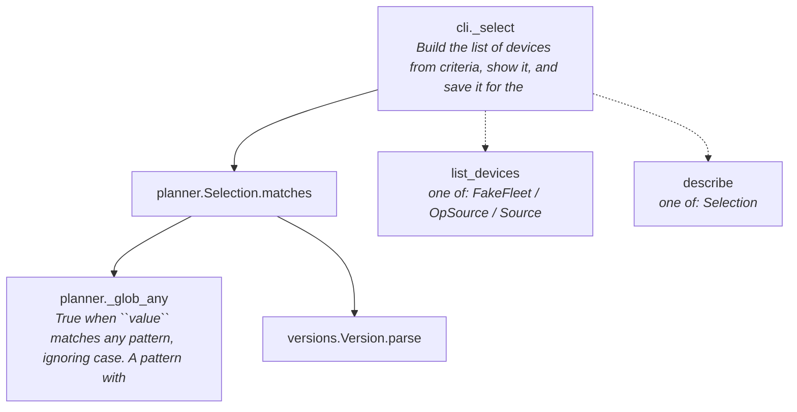
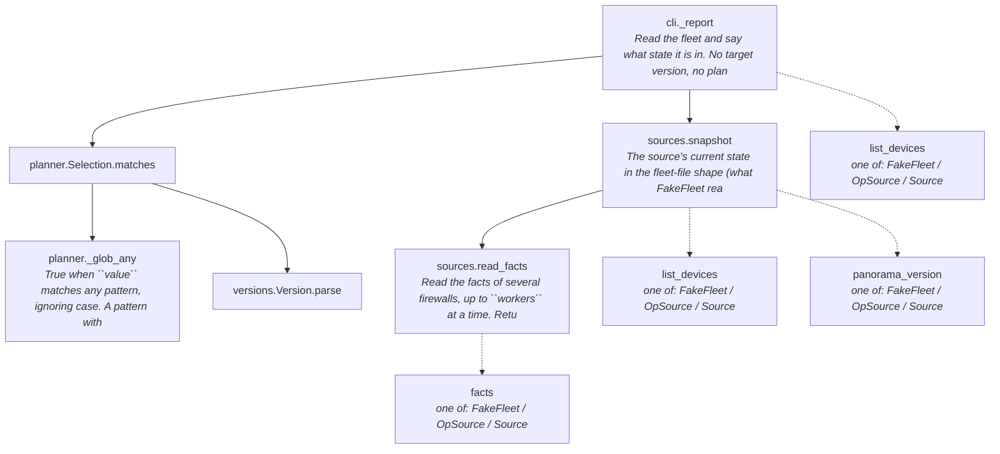
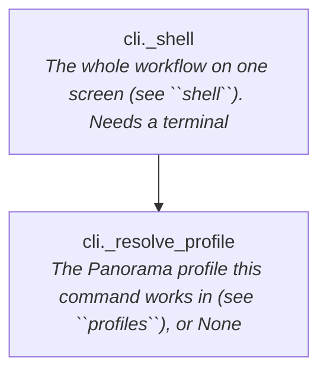
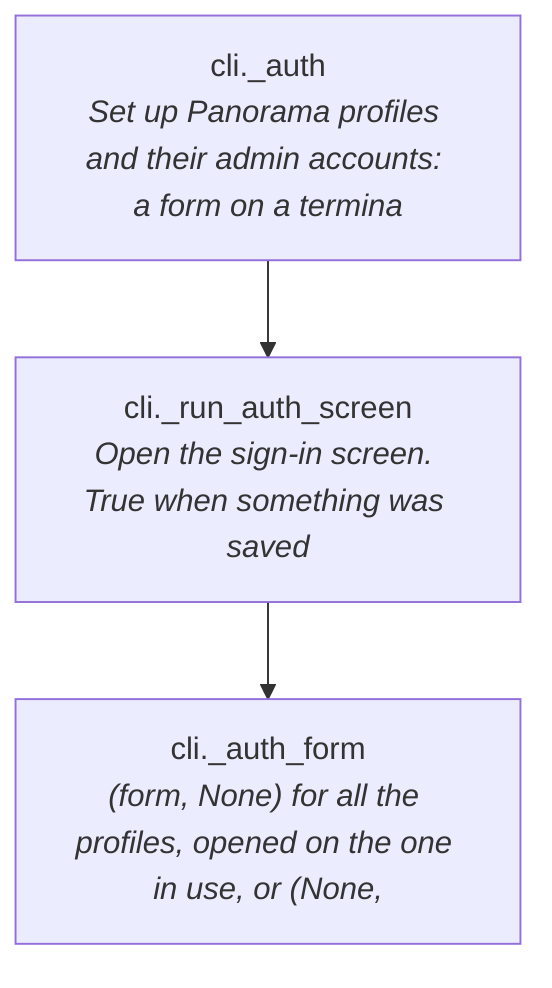
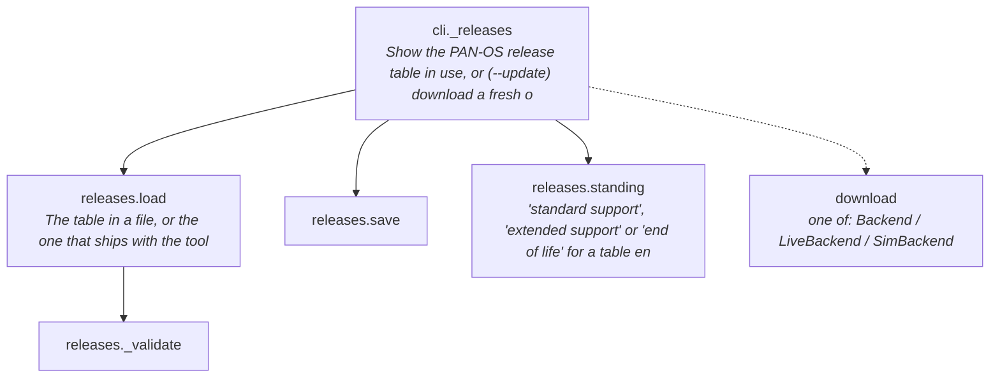
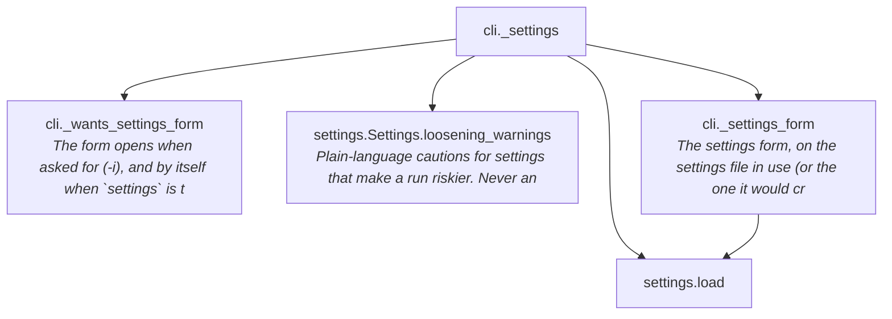

# What each verb calls

Generated by `tools/flowcharts.py` from the source; do not edit by hand. A solid arrow is a call the code makes by name; a dashed arrow is a call to a method whose class is only known at run time (more than one class defines it). Presentation modules (screens, files, text) and sign-in plumbing are left out so the steps stand out; calls made through callbacks are not visible to this reading. Each function is drawn once, at its first appearance, to a depth of 5; only the tool's own work (planning, checks, reading firewalls, executing) is opened up.

## `panupgrade select`

build the device list from criteria, for you to check and edit; changes nothing.

Handler: `_select`

## `panupgrade help`

what each command is for and the order to use them.

Handler: `_help`

## `panupgrade report`

show the state of the fleet right now (versions, HA, sync, content); changes nothing.

Handler: `_report`

## `panupgrade plan`

show what would happen to each device; changes nothing.

Handler: `_plan`

```mermaid
flowchart TD
    n_panupgrade_cli__plan["cli._plan"]
    n_panupgrade_cli__build["cli._build"]
    n_panupgrade_paths_load_rules["paths.load_rules"]
    n_panupgrade_planner_build_plan["planner.build_plan"]
    n_panupgrade_versions_Version_parse["versions.Version.parse"]
    n_panupgrade_planner_Selection_matches["planner.Selection.matches"]
    n_panupgrade_planner__glob_any["planner._glob_any<br/><i>True when ``value`` matches any pattern, ignoring case. A pattern with</i>"]
    n_panupgrade_sources_read_facts["sources.read_facts<br/><i>Read the facts of several firewalls, up to ``workers`` at a time. Retu</i>"]
    n_panupgrade_sources_read_facts_facts["facts<br/><i>one of: FakeFleet / OpSource / Source</i>"]
    n_panupgrade_planner__device["planner._device"]
    n_panupgrade_checks_run_device_checks["checks.run_device_checks<br/><i>Run every check in order. Stops early only when the device cannot be r</i>"]
    n_panupgrade_checks__guard["checks._guard"]
    n_panupgrade_checks_reachable["checks.reachable"]
    n_panupgrade_checks__skip["checks._skip"]
    n_panupgrade_checks_current_version["checks.current_version"]
    n_panupgrade_checks__no_data["checks._no_data"]
    n_panupgrade_checks_upgrade_path["checks.upgrade_path"]
    n_panupgrade_checks__path["checks._path<br/><i>The path from what is running to the target, with the firewall's own b</i>"]
    n_panupgrade_checks_ha_state["checks.ha_state"]
    n_panupgrade_checks_ha_peer["checks.ha_peer"]
    n_panupgrade_checks_preemption["checks.preemption"]
    n_panupgrade_checks_disk_space["checks.disk_space"]
    n_panupgrade_checks__images_already_here["checks._images_already_here<br/><i>True when the upgrade path needs at least one download and every image</i>"]
    n_panupgrade_checks_pending_changes["checks.pending_changes"]
    n_panupgrade_checks_running_jobs["checks.running_jobs"]
    n_panupgrade_checks_session_baseline["checks.session_baseline<br/><i>The active node's session count is the yardstick for the failover and </i>"]
    n_panupgrade_checks_ntp["checks.ntp"]
    n_panupgrade_checks_licenses["checks.licenses"]
    n_panupgrade_checks_panorama_range["checks.panorama_range<br/><i>Advice only, never a blocker: a firewall far behind Panorama is what t</i>"]
    n_panupgrade_releases_default["releases.default<br/><i>The table that ships with the tool, read once</i>"]
    n_panupgrade_releases_Releases_behind["releases.Releases.behind<br/><i>How many ``unit`` ('major' or 'minor') the firewall's release is behin</i>"]
    n_panupgrade_checks__unit_names["checks._unit_names"]
    n_panupgrade_checks__stale_note["checks._stale_note<br/><i>A sentence to add when a release is missing from the table, so a stale</i>"]
    n_panupgrade_checks_certificate_advisory["checks.certificate_advisory<br/><i>Is this build (and the target) one that carries the fix for the certif</i>"]
    n_panupgrade_advisories_load["advisories.load"]
    n_panupgrade_advisories_assess["advisories.assess<br/><i>What the advisories say about a firewall now (running, content) and af</i>"]
    n_panupgrade_checks_device_certificate["checks.device_certificate<br/><i>The device certificate (`show device-certificate status`). Needed by c</i>"]
    n_panupgrade_checks_clock_skew["checks.clock_skew<br/><i>The firewall's clock against Panorama's. A firewall hours off sees val</i>"]
    n_panupgrade_checks_content_minimum["checks.content_minimum<br/><i>PAN-OS refuses to install some releases unless the dynamic content is </i>"]
    n_panupgrade_paths_content_requirement["paths.content_requirement<br/><i>The highest app-content number any installed step needs, as (number, v</i>"]
    n_panupgrade_planner__verdict["planner._verdict"]
    n_panupgrade_planner__apply_standalone["planner._apply_standalone"]
    n_panupgrade_planner__add["planner._add"]
    n_panupgrade_planner__verdict_from_dicts["planner._verdict_from_dicts"]
    n_panupgrade_planner__apply_pair_rules["planner._apply_pair_rules"]
    n_panupgrade_planner__peer_problem["planner._peer_problem<br/><i>Why an HA peer that is not in this run is a problem (words that fit 'i</i>"]
    n_panupgrade_planner__planned_versions["planner._planned_versions"]
    n_panupgrade_checks_fleet_checks["checks.fleet_checks<br/><i>planned_versions: versions the selected firewalls will have after the </i>"]
    n_panupgrade_planner__steps["planner._steps"]
    n_panupgrade_planner__path_steps["planner._path_steps"]
    n_panupgrade_planner__order["planner._order<br/><i>Units in plan order: an HA pair is one unit (passive first), a standal</i>"]
    n_panupgrade_planner__cautions["planner._cautions"]
    n_panupgrade_settings_Settings_loosening_warnings["settings.Settings.loosening_warnings<br/><i>Plain-language cautions for settings that make a run riskier. Never an</i>"]
    n_panupgrade_planner__advice["planner._advice<br/><i>Notes that never need acknowledging and never hold an upgrade</i>"]
    n_panupgrade_checks_lagging_text["checks.lagging_text<br/><i>The advice for firewalls that run too far behind Panorama, said once f</i>"]
    n_panupgrade_planner__summary["planner._summary"]
    n_panupgrade_planner__hash["planner._hash"]
    n_panupgrade_planner__digest["planner._digest"]
    n_panupgrade_planner__digest_body["planner._digest_body<br/><i>What an approval is bound to: everything a person decides on, and noth</i>"]
    n_panupgrade_planner_build_plan_list_devices["list_devices<br/><i>one of: FakeFleet / OpSource / Source</i>"]
    n_panupgrade_planner_build_plan_panorama_version["panorama_version<br/><i>one of: FakeFleet / OpSource / Source</i>"]
    n_panupgrade_planner_build_plan_panorama_clock["panorama_clock<br/><i>one of: FakeFleet / OpSource / Source</i>"]
    n_panupgrade_cli__plan --> n_panupgrade_cli__build
    n_panupgrade_cli__build --> n_panupgrade_paths_load_rules
    n_panupgrade_cli__build --> n_panupgrade_planner_build_plan
    n_panupgrade_planner_build_plan --> n_panupgrade_versions_Version_parse
    n_panupgrade_planner_build_plan --> n_panupgrade_paths_load_rules
    n_panupgrade_planner_build_plan --> n_panupgrade_planner_Selection_matches
    n_panupgrade_planner_Selection_matches --> n_panupgrade_planner__glob_any
    n_panupgrade_planner_Selection_matches --> n_panupgrade_versions_Version_parse
    n_panupgrade_planner_build_plan --> n_panupgrade_sources_read_facts
    n_panupgrade_sources_read_facts -.-> n_panupgrade_sources_read_facts_facts
    n_panupgrade_planner_build_plan --> n_panupgrade_planner__device
    n_panupgrade_planner_build_plan --> n_panupgrade_checks_run_device_checks
    n_panupgrade_checks_run_device_checks --> n_panupgrade_checks__guard
    n_panupgrade_checks_run_device_checks --> n_panupgrade_checks_reachable
    n_panupgrade_checks_reachable --> n_panupgrade_checks__skip
    n_panupgrade_checks_run_device_checks --> n_panupgrade_checks_current_version
    n_panupgrade_checks_current_version --> n_panupgrade_checks__no_data
    n_panupgrade_checks_current_version --> n_panupgrade_versions_Version_parse
    n_panupgrade_checks_current_version --> n_panupgrade_checks__skip
    n_panupgrade_checks_run_device_checks --> n_panupgrade_checks_upgrade_path
    n_panupgrade_checks_upgrade_path --> n_panupgrade_checks__path
    n_panupgrade_checks_upgrade_path --> n_panupgrade_checks__skip
    n_panupgrade_checks_run_device_checks --> n_panupgrade_checks_ha_state
    n_panupgrade_checks_ha_state --> n_panupgrade_checks__no_data
    n_panupgrade_checks_run_device_checks --> n_panupgrade_checks_ha_peer
    n_panupgrade_checks_ha_peer --> n_panupgrade_checks__skip
    n_panupgrade_checks_run_device_checks --> n_panupgrade_checks_preemption
    n_panupgrade_checks_preemption --> n_panupgrade_checks__skip
    n_panupgrade_checks_preemption --> n_panupgrade_checks__no_data
    n_panupgrade_checks_run_device_checks --> n_panupgrade_checks_disk_space
    n_panupgrade_checks_disk_space --> n_panupgrade_checks__no_data
    n_panupgrade_checks_disk_space --> n_panupgrade_checks__images_already_here
    n_panupgrade_checks_run_device_checks --> n_panupgrade_checks_pending_changes
    n_panupgrade_checks_pending_changes --> n_panupgrade_checks__no_data
    n_panupgrade_checks_run_device_checks --> n_panupgrade_checks_running_jobs
    n_panupgrade_checks_running_jobs --> n_panupgrade_checks__no_data
    n_panupgrade_checks_run_device_checks --> n_panupgrade_checks_session_baseline
    n_panupgrade_checks_session_baseline --> n_panupgrade_checks__skip
    n_panupgrade_checks_session_baseline --> n_panupgrade_checks__no_data
    n_panupgrade_checks_run_device_checks --> n_panupgrade_checks_ntp
    n_panupgrade_checks_ntp --> n_panupgrade_checks__no_data
    n_panupgrade_checks_run_device_checks --> n_panupgrade_checks_licenses
    n_panupgrade_checks_licenses --> n_panupgrade_checks__no_data
    n_panupgrade_checks_run_device_checks --> n_panupgrade_checks_panorama_range
    n_panupgrade_checks_panorama_range --> n_panupgrade_checks__no_data
    n_panupgrade_checks_panorama_range --> n_panupgrade_versions_Version_parse
    n_panupgrade_checks_panorama_range --> n_panupgrade_releases_default
    n_panupgrade_checks_panorama_range --> n_panupgrade_releases_Releases_behind
    n_panupgrade_checks_panorama_range --> n_panupgrade_checks__unit_names
    n_panupgrade_checks_panorama_range --> n_panupgrade_checks__stale_note
    n_panupgrade_checks_run_device_checks --> n_panupgrade_checks_certificate_advisory
    n_panupgrade_checks_certificate_advisory --> n_panupgrade_checks__no_data
    n_panupgrade_checks_certificate_advisory --> n_panupgrade_versions_Version_parse
    n_panupgrade_checks_certificate_advisory --> n_panupgrade_checks__skip
    n_panupgrade_checks_certificate_advisory --> n_panupgrade_advisories_load
    n_panupgrade_checks_certificate_advisory --> n_panupgrade_advisories_assess
    n_panupgrade_checks_run_device_checks --> n_panupgrade_checks_device_certificate
    n_panupgrade_checks_device_certificate --> n_panupgrade_checks__no_data
    n_panupgrade_checks_run_device_checks --> n_panupgrade_checks_clock_skew
    n_panupgrade_checks_clock_skew --> n_panupgrade_checks__no_data
    n_panupgrade_checks_run_device_checks --> n_panupgrade_checks_content_minimum
    n_panupgrade_checks_content_minimum --> n_panupgrade_checks__path
    n_panupgrade_checks_content_minimum --> n_panupgrade_checks__skip
    n_panupgrade_checks_content_minimum --> n_panupgrade_paths_content_requirement
    n_panupgrade_planner_build_plan --> n_panupgrade_planner__verdict
    n_panupgrade_planner_build_plan --> n_panupgrade_planner__apply_standalone
    n_panupgrade_planner__apply_standalone --> n_panupgrade_planner__add
    n_panupgrade_planner__add --> n_panupgrade_planner__verdict_from_dicts
    n_panupgrade_planner_build_plan --> n_panupgrade_planner__apply_pair_rules
    n_panupgrade_planner__apply_pair_rules --> n_panupgrade_planner__add
    n_panupgrade_planner__apply_pair_rules --> n_panupgrade_versions_Version_parse
    n_panupgrade_planner__apply_pair_rules --> n_panupgrade_planner__peer_problem
    n_panupgrade_planner_build_plan --> n_panupgrade_planner__planned_versions
    n_panupgrade_planner__planned_versions --> n_panupgrade_versions_Version_parse
    n_panupgrade_planner_build_plan --> n_panupgrade_checks_fleet_checks
    n_panupgrade_checks_fleet_checks --> n_panupgrade_checks__skip
    n_panupgrade_checks_fleet_checks --> n_panupgrade_versions_Version_parse
    n_panupgrade_checks_fleet_checks --> n_panupgrade_releases_default
    n_panupgrade_checks_fleet_checks --> n_panupgrade_checks__unit_names
    n_panupgrade_checks_fleet_checks --> n_panupgrade_checks__stale_note
    n_panupgrade_checks_fleet_checks --> n_panupgrade_releases_Releases_behind
    n_panupgrade_planner_build_plan --> n_panupgrade_planner__steps
    n_panupgrade_planner__steps --> n_panupgrade_planner__path_steps
    n_panupgrade_planner_build_plan --> n_panupgrade_planner__order
    n_panupgrade_planner_build_plan --> n_panupgrade_planner__cautions
    n_panupgrade_planner_build_plan --> n_panupgrade_settings_Settings_loosening_warnings
    n_panupgrade_planner_build_plan --> n_panupgrade_planner__advice
    n_panupgrade_planner__advice --> n_panupgrade_checks__stale_note
    n_panupgrade_planner__advice --> n_panupgrade_versions_Version_parse
    n_panupgrade_planner__advice --> n_panupgrade_checks__unit_names
    n_panupgrade_planner__advice --> n_panupgrade_checks_lagging_text
    n_panupgrade_checks_lagging_text --> n_panupgrade_checks__unit_names
    n_panupgrade_planner_build_plan --> n_panupgrade_planner__summary
    n_panupgrade_planner_build_plan --> n_panupgrade_planner__hash
    n_panupgrade_planner_build_plan --> n_panupgrade_planner__digest
    n_panupgrade_planner__digest --> n_panupgrade_planner__digest_body
    n_panupgrade_planner_build_plan --> n_panupgrade_planner__digest_body
    n_panupgrade_planner_build_plan -.-> n_panupgrade_planner_build_plan_list_devices
    n_panupgrade_planner_build_plan -.-> n_panupgrade_planner_build_plan_panorama_version
    n_panupgrade_planner_build_plan -.-> n_panupgrade_planner_build_plan_panorama_clock
```

## `panupgrade upgrade`

carry out an approved upgrade: REAL with a live source, or --dry-run to rehearse it against a model of the fleet.

Handler: `_upgrade`

```mermaid
flowchart TD
    n_panupgrade_cli__upgrade["cli._upgrade"]
    n_panupgrade_cli__upgrade_execute["cli._upgrade_execute<br/><i>Carry out a reviewed upgrade. ``approve(journal_path)`` returns the Ap</i>"]
    n_panupgrade_cli_UpgradeBundle_ready["cli.UpgradeBundle.ready"]
    n_panupgrade_cli_UpgradeBundle_acks["cli.UpgradeBundle.acks"]
    n_panupgrade_cli__choose_journal["cli._choose_journal<br/><i>Decide which journal file this run uses, without creating it. Returns </i>"]
    n_panupgrade_cli__has_steps["cli._has_steps<br/><i>True if the journal file records any step (not just its header line)</i>"]
    n_panupgrade_cli__unfinished_run["cli._unfinished_run<br/><i>The newest earlier run of exactly this plan that did not finish, as (J</i>"]
    n_panupgrade_cli__expected_steps["cli._expected_steps<br/><i>For each firewall the plan will change: every journal key a finished r</i>"]
    n_panupgrade_executor_run["executor.run<br/><i>Carry out the plan. Units (an HA pair, or a standalone firewall) run i</i>"]
    n_panupgrade_executor__failed_in_journal["executor._failed_in_journal"]
    n_panupgrade_executor__run_device["executor._run_device"]
    n_panupgrade_executor__step["executor._step"]
    n_panupgrade_executor__preflight["executor._preflight"]
    n_panupgrade_executor__preflight_preflight["preflight<br/><i>one of: Backend / LiveBackend / SimBackend</i>"]
    n_panupgrade_executor__key["executor._key"]
    n_panupgrade_executor__do["executor._do"]
    n_panupgrade_executor__backup_verified["executor._backup_verified"]
    n_panupgrade_executor__baseline["executor._baseline<br/><i>The pair's session baseline: the count on the node that was active bef</i>"]
    n_panupgrade_executor__wait_for_quiet["executor._wait_for_quiet<br/><i>A config sync, an HA state change or a boot queues a commit on the fir</i>"]
    n_panupgrade_executor__target_version["executor._target_version<br/><i>The version a device ends on: the last install in its steps</i>"]
    n_panupgrade_executor__band_ok["executor._band_ok"]
    n_panupgrade_executor__settle["executor._settle<br/><i>Wait ``seconds``, then until the firewall has no unfinished job, befor</i>"]
    n_panupgrade_executor__retry_while_busy["executor._retry_while_busy<br/><i>Run a command the firewall may refuse because it is busy. The jobs lis</i>"]
    n_panupgrade_executor__expected_version["executor._expected_version"]
    n_panupgrade_executor__do_download["download<br/><i>one of: Backend / LiveBackend / SimBackend</i>"]
    n_panupgrade_executor__do_backup["backup<br/><i>one of: Backend / LiveBackend / SimBackend</i>"]
    n_panupgrade_executor__do_sync_to_peer["sync_to_peer<br/><i>one of: Backend / LiveBackend / SimBackend</i>"]
    n_panupgrade_executor__do_suspend["suspend<br/><i>one of: Backend / LiveBackend / SimBackend</i>"]
    n_panupgrade_executor__do_functional["functional<br/><i>one of: Backend / LiveBackend / SimBackend</i>"]
    n_panupgrade_executor__do_install["install<br/><i>one of: Backend / LiveBackend / SimBackend</i>"]
    n_panupgrade_executor__do_reboot_and_wait["reboot_and_wait<br/><i>one of: Backend / LiveBackend / SimBackend</i>"]
    n_panupgrade_executor__standing["executor._standing<br/><i>Where a firewall stands when the step at ``index`` did not finish: whi</i>"]
    n_panupgrade_cli__upgrade_execute_from_file["from_file<br/><i>one of: FakeFleet</i>"]
    n_panupgrade_cli__upgrade_review["cli._upgrade_review<br/><i>Read the fleet and build the upgrade plan. Changes nothing. With ``sho</i>"]
    n_panupgrade_cli__build["cli._build"]
    n_panupgrade_paths_load_rules["paths.load_rules"]
    n_panupgrade_planner_build_plan["planner.build_plan"]
    n_panupgrade_versions_Version_parse["versions.Version.parse"]
    n_panupgrade_planner_Selection_matches["planner.Selection.matches"]
    n_panupgrade_planner__glob_any["planner._glob_any<br/><i>True when ``value`` matches any pattern, ignoring case. A pattern with</i>"]
    n_panupgrade_sources_read_facts["sources.read_facts<br/><i>Read the facts of several firewalls, up to ``workers`` at a time. Retu</i>"]
    n_panupgrade_sources_read_facts_facts["facts<br/><i>one of: FakeFleet / OpSource / Source</i>"]
    n_panupgrade_planner__device["planner._device"]
    n_panupgrade_checks_run_device_checks["checks.run_device_checks<br/><i>Run every check in order. Stops early only when the device cannot be r</i>"]
    n_panupgrade_checks__guard["checks._guard"]
    n_panupgrade_checks_reachable["checks.reachable"]
    n_panupgrade_checks_current_version["checks.current_version"]
    n_panupgrade_checks_upgrade_path["checks.upgrade_path"]
    n_panupgrade_checks_ha_state["checks.ha_state"]
    n_panupgrade_checks_ha_peer["checks.ha_peer"]
    n_panupgrade_checks_preemption["checks.preemption"]
    n_panupgrade_checks_disk_space["checks.disk_space"]
    n_panupgrade_checks_pending_changes["checks.pending_changes"]
    n_panupgrade_checks_running_jobs["checks.running_jobs"]
    n_panupgrade_checks_session_baseline["checks.session_baseline<br/><i>The active node's session count is the yardstick for the failover and </i>"]
    n_panupgrade_checks_ntp["checks.ntp"]
    n_panupgrade_checks_licenses["checks.licenses"]
    n_panupgrade_checks_panorama_range["checks.panorama_range<br/><i>Advice only, never a blocker: a firewall far behind Panorama is what t</i>"]
    n_panupgrade_checks_certificate_advisory["checks.certificate_advisory<br/><i>Is this build (and the target) one that carries the fix for the certif</i>"]
    n_panupgrade_checks_device_certificate["checks.device_certificate<br/><i>The device certificate (`show device-certificate status`). Needed by c</i>"]
    n_panupgrade_checks_clock_skew["checks.clock_skew<br/><i>The firewall's clock against Panorama's. A firewall hours off sees val</i>"]
    n_panupgrade_checks_content_minimum["checks.content_minimum<br/><i>PAN-OS refuses to install some releases unless the dynamic content is </i>"]
    n_panupgrade_planner__verdict["planner._verdict"]
    n_panupgrade_planner__apply_standalone["planner._apply_standalone"]
    n_panupgrade_planner__add["planner._add"]
    n_panupgrade_planner__apply_pair_rules["planner._apply_pair_rules"]
    n_panupgrade_planner__peer_problem["planner._peer_problem<br/><i>Why an HA peer that is not in this run is a problem (words that fit 'i</i>"]
    n_panupgrade_planner__planned_versions["planner._planned_versions"]
    n_panupgrade_checks_fleet_checks["checks.fleet_checks<br/><i>planned_versions: versions the selected firewalls will have after the </i>"]
    n_panupgrade_checks__skip["checks._skip"]
    n_panupgrade_releases_default["releases.default<br/><i>The table that ships with the tool, read once</i>"]
    n_panupgrade_checks__unit_names["checks._unit_names"]
    n_panupgrade_checks__stale_note["checks._stale_note<br/><i>A sentence to add when a release is missing from the table, so a stale</i>"]
    n_panupgrade_releases_Releases_behind["releases.Releases.behind<br/><i>How many ``unit`` ('major' or 'minor') the firewall's release is behin</i>"]
    n_panupgrade_planner__steps["planner._steps"]
    n_panupgrade_planner__path_steps["planner._path_steps"]
    n_panupgrade_planner__order["planner._order<br/><i>Units in plan order: an HA pair is one unit (passive first), a standal</i>"]
    n_panupgrade_planner__cautions["planner._cautions"]
    n_panupgrade_settings_Settings_loosening_warnings["settings.Settings.loosening_warnings<br/><i>Plain-language cautions for settings that make a run riskier. Never an</i>"]
    n_panupgrade_planner__advice["planner._advice<br/><i>Notes that never need acknowledging and never hold an upgrade</i>"]
    n_panupgrade_checks_lagging_text["checks.lagging_text<br/><i>The advice for firewalls that run too far behind Panorama, said once f</i>"]
    n_panupgrade_planner__summary["planner._summary"]
    n_panupgrade_planner__hash["planner._hash"]
    n_panupgrade_planner__digest["planner._digest"]
    n_panupgrade_planner__digest_body["planner._digest_body<br/><i>What an approval is bound to: everything a person decides on, and noth</i>"]
    n_panupgrade_planner_build_plan_list_devices["list_devices<br/><i>one of: FakeFleet / OpSource / Source</i>"]
    n_panupgrade_planner_build_plan_panorama_version["panorama_version<br/><i>one of: FakeFleet / OpSource / Source</i>"]
    n_panupgrade_planner_build_plan_panorama_clock["panorama_clock<br/><i>one of: FakeFleet / OpSource / Source</i>"]
    n_panupgrade_cli__upgrade --> n_panupgrade_cli__upgrade_execute
    n_panupgrade_cli__upgrade_execute --> n_panupgrade_cli_UpgradeBundle_ready
    n_panupgrade_cli__upgrade_execute --> n_panupgrade_cli_UpgradeBundle_acks
    n_panupgrade_cli__upgrade_execute --> n_panupgrade_cli__choose_journal
    n_panupgrade_cli__choose_journal --> n_panupgrade_cli__has_steps
    n_panupgrade_cli__choose_journal --> n_panupgrade_cli__unfinished_run
    n_panupgrade_cli__unfinished_run --> n_panupgrade_cli__expected_steps
    n_panupgrade_cli__upgrade_execute --> n_panupgrade_executor_run
    n_panupgrade_executor_run --> n_panupgrade_executor__failed_in_journal
    n_panupgrade_executor_run --> n_panupgrade_executor__run_device
    n_panupgrade_executor__run_device --> n_panupgrade_executor__failed_in_journal
    n_panupgrade_executor__run_device --> n_panupgrade_executor__step
    n_panupgrade_executor__run_device --> n_panupgrade_executor__preflight
    n_panupgrade_executor__preflight -.-> n_panupgrade_executor__preflight_preflight
    n_panupgrade_executor__run_device --> n_panupgrade_executor__key
    n_panupgrade_executor__run_device --> n_panupgrade_executor__do
    n_panupgrade_executor__do --> n_panupgrade_executor__backup_verified
    n_panupgrade_executor__do --> n_panupgrade_executor__baseline
    n_panupgrade_executor__do --> n_panupgrade_executor__wait_for_quiet
    n_panupgrade_executor__do --> n_panupgrade_executor__target_version
    n_panupgrade_executor__do --> n_panupgrade_executor__band_ok
    n_panupgrade_executor__do --> n_panupgrade_executor__settle
    n_panupgrade_executor__do --> n_panupgrade_executor__retry_while_busy
    n_panupgrade_executor__do --> n_panupgrade_executor__expected_version
    n_panupgrade_executor__do -.-> n_panupgrade_executor__do_download
    n_panupgrade_executor__do -.-> n_panupgrade_executor__do_backup
    n_panupgrade_executor__do -.-> n_panupgrade_executor__do_sync_to_peer
    n_panupgrade_executor__do -.-> n_panupgrade_executor__do_suspend
    n_panupgrade_executor__do -.-> n_panupgrade_executor__do_functional
    n_panupgrade_executor__do -.-> n_panupgrade_executor__do_install
    n_panupgrade_executor__do -.-> n_panupgrade_executor__do_reboot_and_wait
    n_panupgrade_executor__run_device --> n_panupgrade_executor__standing
    n_panupgrade_executor__standing --> n_panupgrade_executor__key
    n_panupgrade_executor_run --> n_panupgrade_executor__standing
    n_panupgrade_cli__upgrade_execute -.-> n_panupgrade_cli__upgrade_execute_from_file
    n_panupgrade_cli__upgrade --> n_panupgrade_cli__upgrade_review
    n_panupgrade_cli__upgrade_review --> n_panupgrade_cli__build
    n_panupgrade_cli__build --> n_panupgrade_paths_load_rules
    n_panupgrade_cli__build --> n_panupgrade_planner_build_plan
    n_panupgrade_planner_build_plan --> n_panupgrade_versions_Version_parse
    n_panupgrade_planner_build_plan --> n_panupgrade_paths_load_rules
    n_panupgrade_planner_build_plan --> n_panupgrade_planner_Selection_matches
    n_panupgrade_planner_Selection_matches --> n_panupgrade_planner__glob_any
    n_panupgrade_planner_Selection_matches --> n_panupgrade_versions_Version_parse
    n_panupgrade_planner_build_plan --> n_panupgrade_sources_read_facts
    n_panupgrade_sources_read_facts -.-> n_panupgrade_sources_read_facts_facts
    n_panupgrade_planner_build_plan --> n_panupgrade_planner__device
    n_panupgrade_planner_build_plan --> n_panupgrade_checks_run_device_checks
    n_panupgrade_checks_run_device_checks --> n_panupgrade_checks__guard
    n_panupgrade_checks_run_device_checks --> n_panupgrade_checks_reachable
    n_panupgrade_checks_run_device_checks --> n_panupgrade_checks_current_version
    n_panupgrade_checks_run_device_checks --> n_panupgrade_checks_upgrade_path
    n_panupgrade_checks_run_device_checks --> n_panupgrade_checks_ha_state
    n_panupgrade_checks_run_device_checks --> n_panupgrade_checks_ha_peer
    n_panupgrade_checks_run_device_checks --> n_panupgrade_checks_preemption
    n_panupgrade_checks_run_device_checks --> n_panupgrade_checks_disk_space
    n_panupgrade_checks_run_device_checks --> n_panupgrade_checks_pending_changes
    n_panupgrade_checks_run_device_checks --> n_panupgrade_checks_running_jobs
    n_panupgrade_checks_run_device_checks --> n_panupgrade_checks_session_baseline
    n_panupgrade_checks_run_device_checks --> n_panupgrade_checks_ntp
    n_panupgrade_checks_run_device_checks --> n_panupgrade_checks_licenses
    n_panupgrade_checks_run_device_checks --> n_panupgrade_checks_panorama_range
    n_panupgrade_checks_run_device_checks --> n_panupgrade_checks_certificate_advisory
    n_panupgrade_checks_run_device_checks --> n_panupgrade_checks_device_certificate
    n_panupgrade_checks_run_device_checks --> n_panupgrade_checks_clock_skew
    n_panupgrade_checks_run_device_checks --> n_panupgrade_checks_content_minimum
    n_panupgrade_planner_build_plan --> n_panupgrade_planner__verdict
    n_panupgrade_planner_build_plan --> n_panupgrade_planner__apply_standalone
    n_panupgrade_planner__apply_standalone --> n_panupgrade_planner__add
    n_panupgrade_planner_build_plan --> n_panupgrade_planner__apply_pair_rules
    n_panupgrade_planner__apply_pair_rules --> n_panupgrade_planner__add
    n_panupgrade_planner__apply_pair_rules --> n_panupgrade_versions_Version_parse
    n_panupgrade_planner__apply_pair_rules --> n_panupgrade_planner__peer_problem
    n_panupgrade_planner_build_plan --> n_panupgrade_planner__planned_versions
    n_panupgrade_planner__planned_versions --> n_panupgrade_versions_Version_parse
    n_panupgrade_planner_build_plan --> n_panupgrade_checks_fleet_checks
    n_panupgrade_checks_fleet_checks --> n_panupgrade_checks__skip
    n_panupgrade_checks_fleet_checks --> n_panupgrade_versions_Version_parse
    n_panupgrade_checks_fleet_checks --> n_panupgrade_releases_default
    n_panupgrade_checks_fleet_checks --> n_panupgrade_checks__unit_names
    n_panupgrade_checks_fleet_checks --> n_panupgrade_checks__stale_note
    n_panupgrade_checks_fleet_checks --> n_panupgrade_releases_Releases_behind
    n_panupgrade_planner_build_plan --> n_panupgrade_planner__steps
    n_panupgrade_planner__steps --> n_panupgrade_planner__path_steps
    n_panupgrade_planner_build_plan --> n_panupgrade_planner__order
    n_panupgrade_planner_build_plan --> n_panupgrade_planner__cautions
    n_panupgrade_planner_build_plan --> n_panupgrade_settings_Settings_loosening_warnings
    n_panupgrade_planner_build_plan --> n_panupgrade_planner__advice
    n_panupgrade_planner__advice --> n_panupgrade_checks__stale_note
    n_panupgrade_planner__advice --> n_panupgrade_versions_Version_parse
    n_panupgrade_planner__advice --> n_panupgrade_checks__unit_names
    n_panupgrade_planner__advice --> n_panupgrade_checks_lagging_text
    n_panupgrade_planner_build_plan --> n_panupgrade_planner__summary
    n_panupgrade_planner_build_plan --> n_panupgrade_planner__hash
    n_panupgrade_planner_build_plan --> n_panupgrade_planner__digest
    n_panupgrade_planner__digest --> n_panupgrade_planner__digest_body
    n_panupgrade_planner_build_plan --> n_panupgrade_planner__digest_body
    n_panupgrade_planner_build_plan -.-> n_panupgrade_planner_build_plan_list_devices
    n_panupgrade_planner_build_plan -.-> n_panupgrade_planner_build_plan_panorama_version
    n_panupgrade_planner_build_plan -.-> n_panupgrade_planner_build_plan_panorama_clock
    n_panupgrade_cli__upgrade_review --> n_panupgrade_cli__unfinished_run
```

## `panupgrade prepare`

pre-maintenance: sync HA config, pre-download images, review the upgrade, and write its approval and run script.

Handler: `_prepare`

```mermaid
flowchart TD
    n_panupgrade_cli__prepare["cli._prepare"]
    n_panupgrade_cli__prepare_execute["cli._prepare_execute<br/><i>Carry out a reviewed prepare. ``approve(journal_path)`` returns the Ap</i>"]
    n_panupgrade_cli__prepare_tasks["cli._prepare_tasks<br/><i>Approve and run the preparation tasks (config sync, image downloads). </i>"]
    n_panupgrade_cli__choose_journal["cli._choose_journal<br/><i>Decide which journal file this run uses, without creating it. Returns </i>"]
    n_panupgrade_cli__has_steps["cli._has_steps<br/><i>True if the journal file records any step (not just its header line)</i>"]
    n_panupgrade_cli__unfinished_run["cli._unfinished_run<br/><i>The newest earlier run of exactly this plan that did not finish, as (J</i>"]
    n_panupgrade_cli__expected_steps["cli._expected_steps<br/><i>For each firewall the plan will change: every journal key a finished r</i>"]
    n_panupgrade_prepare_describe["prepare.describe<br/><i>One line per task, for the screen and for the approval prompt</i>"]
    n_panupgrade_prepare_diff_text["prepare.diff_text"]
    n_panupgrade_prepare_deletion_lines["prepare.deletion_lines<br/><i>One line per firewall that has images to delete, saying which and what</i>"]
    n_panupgrade_cli__prepare_heading["cli._prepare_heading<br/><i>What the approval is told it is approving; content updates are said pl</i>"]
    n_panupgrade_prepare_run["prepare.run"]
    n_panupgrade_prepare_content_diffs["prepare.content_diffs<br/><i>{key: (a_value, b_value)} for each content type whose installed versio</i>"]
    n_panupgrade_prepare__norm["prepare._norm"]
    n_panupgrade_prepare__highest_first["prepare._highest_first<br/><i>Deletions with the higher releases first, so a base image goes only af</i>"]
    n_panupgrade_versions_Version_parse["versions.Version.parse"]
    n_panupgrade_prepare__fold["prepare._fold"]
    n_panupgrade_prepare_run_backup["backup<br/><i>one of: Backend / LiveBackend / SimBackend</i>"]
    n_panupgrade_prepare_run_content_versions["content_versions<br/><i>one of: Backend / LiveBackend / SimBackend</i>"]
    n_panupgrade_prepare_run_sync_to_peer["sync_to_peer<br/><i>one of: Backend / LiveBackend / SimBackend</i>"]
    n_panupgrade_prepare_run_refresh_updates["refresh_updates<br/><i>one of: Backend / LiveBackend / SimBackend</i>"]
    n_panupgrade_prepare_run_update_content["update_content<br/><i>one of: Backend / LiveBackend / SimBackend</i>"]
    n_panupgrade_prepare_run_delete_image["delete_image<br/><i>one of: Backend / LiveBackend / SimBackend</i>"]
    n_panupgrade_prepare_run_download["download<br/><i>one of: Backend / LiveBackend / SimBackend</i>"]
    n_panupgrade_cli__prepare_tasks_from_file["from_file<br/><i>one of: FakeFleet</i>"]
    n_panupgrade_cli__issue_kit["cli._issue_kit<br/><i>After the preparation: show the upgrade plan as it now stands, ask onc</i>"]
    n_panupgrade_cli__build["cli._build"]
    n_panupgrade_paths_load_rules["paths.load_rules"]
    n_panupgrade_planner_build_plan["planner.build_plan"]
    n_panupgrade_planner_Selection_matches["planner.Selection.matches"]
    n_panupgrade_sources_read_facts["sources.read_facts<br/><i>Read the facts of several firewalls, up to ``workers`` at a time. Retu</i>"]
    n_panupgrade_planner__device["planner._device"]
    n_panupgrade_checks_run_device_checks["checks.run_device_checks<br/><i>Run every check in order. Stops early only when the device cannot be r</i>"]
    n_panupgrade_planner__verdict["planner._verdict"]
    n_panupgrade_planner__apply_standalone["planner._apply_standalone"]
    n_panupgrade_planner__apply_pair_rules["planner._apply_pair_rules"]
    n_panupgrade_planner__planned_versions["planner._planned_versions"]
    n_panupgrade_checks_fleet_checks["checks.fleet_checks<br/><i>planned_versions: versions the selected firewalls will have after the </i>"]
    n_panupgrade_planner__steps["planner._steps"]
    n_panupgrade_planner__order["planner._order<br/><i>Units in plan order: an HA pair is one unit (passive first), a standal</i>"]
    n_panupgrade_planner__cautions["planner._cautions"]
    n_panupgrade_settings_Settings_loosening_warnings["settings.Settings.loosening_warnings<br/><i>Plain-language cautions for settings that make a run riskier. Never an</i>"]
    n_panupgrade_planner__advice["planner._advice<br/><i>Notes that never need acknowledging and never hold an upgrade</i>"]
    n_panupgrade_planner__summary["planner._summary"]
    n_panupgrade_planner__hash["planner._hash"]
    n_panupgrade_planner__digest["planner._digest"]
    n_panupgrade_planner__digest_body["planner._digest_body<br/><i>What an approval is bound to: everything a person decides on, and noth</i>"]
    n_panupgrade_planner_build_plan_list_devices["list_devices<br/><i>one of: FakeFleet / OpSource / Source</i>"]
    n_panupgrade_planner_build_plan_panorama_version["panorama_version<br/><i>one of: FakeFleet / OpSource / Source</i>"]
    n_panupgrade_planner_build_plan_panorama_clock["panorama_clock<br/><i>one of: FakeFleet / OpSource / Source</i>"]
    n_panupgrade_cli__prepare_review["cli._prepare_review<br/><i>Read the fleet and say what prepare would do. Changes nothing. Returns</i>"]
    n_panupgrade_prepare_build["prepare.build"]
    n_panupgrade_paths_compute["paths.compute<br/><i>The path from ``current`` to ``target``. ``bases``: what the firewall </i>"]
    n_panupgrade_releases_default["releases.default<br/><i>The table that ships with the tool, read once</i>"]
    n_panupgrade_releases_load["releases.load<br/><i>The table in a file, or the one that ships with the tool</i>"]
    n_panupgrade_paths_base_for["paths.base_for<br/><i>The image every install in a feature release needs on the box first. `</i>"]
    n_panupgrade_paths_content_requirement["paths.content_requirement<br/><i>The highest app-content number any installed step needs, as (number, v</i>"]
    n_panupgrade_paths_keep_images["paths.keep_images<br/><i>The PAN-OS images a firewall must keep for this upgrade, as version st</i>"]
    n_panupgrade_prepare_content_state["prepare.content_state<br/><i>What each pair has LOADED, in words. This is what `show system info` r</i>"]
    n_panupgrade_prepare_build_list_devices["list_devices<br/><i>one of: FakeFleet / OpSource / Source</i>"]
    n_panupgrade_prepare_build_facts["facts<br/><i>one of: FakeFleet / OpSource / Source</i>"]
    n_panupgrade_cli__prepare --> n_panupgrade_cli__prepare_execute
    n_panupgrade_cli__prepare_execute --> n_panupgrade_cli__prepare_tasks
    n_panupgrade_cli__prepare_tasks --> n_panupgrade_cli__choose_journal
    n_panupgrade_cli__choose_journal --> n_panupgrade_cli__has_steps
    n_panupgrade_cli__choose_journal --> n_panupgrade_cli__unfinished_run
    n_panupgrade_cli__unfinished_run --> n_panupgrade_cli__expected_steps
    n_panupgrade_cli__prepare_tasks --> n_panupgrade_prepare_describe
    n_panupgrade_prepare_describe --> n_panupgrade_prepare_diff_text
    n_panupgrade_prepare_describe --> n_panupgrade_prepare_deletion_lines
    n_panupgrade_cli__prepare_tasks --> n_panupgrade_cli__prepare_heading
    n_panupgrade_cli__prepare_tasks --> n_panupgrade_prepare_run
    n_panupgrade_prepare_run --> n_panupgrade_prepare_content_diffs
    n_panupgrade_prepare_content_diffs --> n_panupgrade_prepare__norm
    n_panupgrade_prepare_run --> n_panupgrade_prepare_diff_text
    n_panupgrade_prepare_run --> n_panupgrade_prepare__highest_first
    n_panupgrade_prepare__highest_first --> n_panupgrade_versions_Version_parse
    n_panupgrade_prepare_run --> n_panupgrade_prepare__fold
    n_panupgrade_prepare_run -.-> n_panupgrade_prepare_run_backup
    n_panupgrade_prepare_run -.-> n_panupgrade_prepare_run_content_versions
    n_panupgrade_prepare_run -.-> n_panupgrade_prepare_run_sync_to_peer
    n_panupgrade_prepare_run -.-> n_panupgrade_prepare_run_refresh_updates
    n_panupgrade_prepare_run -.-> n_panupgrade_prepare_run_update_content
    n_panupgrade_prepare_run -.-> n_panupgrade_prepare_run_delete_image
    n_panupgrade_prepare_run -.-> n_panupgrade_prepare_run_download
    n_panupgrade_cli__prepare_tasks -.-> n_panupgrade_cli__prepare_tasks_from_file
    n_panupgrade_cli__prepare_execute --> n_panupgrade_cli__issue_kit
    n_panupgrade_cli__issue_kit --> n_panupgrade_cli__build
    n_panupgrade_cli__build --> n_panupgrade_paths_load_rules
    n_panupgrade_cli__build --> n_panupgrade_planner_build_plan
    n_panupgrade_planner_build_plan --> n_panupgrade_versions_Version_parse
    n_panupgrade_planner_build_plan --> n_panupgrade_paths_load_rules
    n_panupgrade_planner_build_plan --> n_panupgrade_planner_Selection_matches
    n_panupgrade_planner_build_plan --> n_panupgrade_sources_read_facts
    n_panupgrade_planner_build_plan --> n_panupgrade_planner__device
    n_panupgrade_planner_build_plan --> n_panupgrade_checks_run_device_checks
    n_panupgrade_planner_build_plan --> n_panupgrade_planner__verdict
    n_panupgrade_planner_build_plan --> n_panupgrade_planner__apply_standalone
    n_panupgrade_planner_build_plan --> n_panupgrade_planner__apply_pair_rules
    n_panupgrade_planner_build_plan --> n_panupgrade_planner__planned_versions
    n_panupgrade_planner_build_plan --> n_panupgrade_checks_fleet_checks
    n_panupgrade_planner_build_plan --> n_panupgrade_planner__steps
    n_panupgrade_planner_build_plan --> n_panupgrade_planner__order
    n_panupgrade_planner_build_plan --> n_panupgrade_planner__cautions
    n_panupgrade_planner_build_plan --> n_panupgrade_settings_Settings_loosening_warnings
    n_panupgrade_planner_build_plan --> n_panupgrade_planner__advice
    n_panupgrade_planner_build_plan --> n_panupgrade_planner__summary
    n_panupgrade_planner_build_plan --> n_panupgrade_planner__hash
    n_panupgrade_planner_build_plan --> n_panupgrade_planner__digest
    n_panupgrade_planner_build_plan --> n_panupgrade_planner__digest_body
    n_panupgrade_planner_build_plan -.-> n_panupgrade_planner_build_plan_list_devices
    n_panupgrade_planner_build_plan -.-> n_panupgrade_planner_build_plan_panorama_version
    n_panupgrade_planner_build_plan -.-> n_panupgrade_planner_build_plan_panorama_clock
    n_panupgrade_cli__prepare --> n_panupgrade_cli__prepare_review
    n_panupgrade_cli__prepare_review --> n_panupgrade_paths_load_rules
    n_panupgrade_cli__prepare_review --> n_panupgrade_prepare_build
    n_panupgrade_prepare_build --> n_panupgrade_paths_load_rules
    n_panupgrade_prepare_build --> n_panupgrade_versions_Version_parse
    n_panupgrade_prepare_build --> n_panupgrade_planner_Selection_matches
    n_panupgrade_prepare_build --> n_panupgrade_sources_read_facts
    n_panupgrade_prepare_build --> n_panupgrade_paths_compute
    n_panupgrade_paths_compute --> n_panupgrade_versions_Version_parse
    n_panupgrade_paths_compute --> n_panupgrade_releases_default
    n_panupgrade_releases_default --> n_panupgrade_releases_load
    n_panupgrade_paths_compute --> n_panupgrade_paths_base_for
    n_panupgrade_prepare_build --> n_panupgrade_paths_content_requirement
    n_panupgrade_paths_content_requirement --> n_panupgrade_versions_Version_parse
    n_panupgrade_prepare_build --> n_panupgrade_paths_keep_images
    n_panupgrade_paths_keep_images --> n_panupgrade_versions_Version_parse
    n_panupgrade_paths_keep_images --> n_panupgrade_paths_base_for
    n_panupgrade_prepare_build --> n_panupgrade_prepare_content_diffs
    n_panupgrade_prepare_build --> n_panupgrade_prepare_content_state
    n_panupgrade_prepare_content_state --> n_panupgrade_prepare__norm
    n_panupgrade_prepare_build --> n_panupgrade_prepare__norm
    n_panupgrade_prepare_build -.-> n_panupgrade_prepare_build_list_devices
    n_panupgrade_prepare_build -.-> n_panupgrade_prepare_build_facts
    n_panupgrade_cli__prepare_review --> n_panupgrade_prepare_deletion_lines
```

## `panupgrade shell`

the whole workflow on one screen (this is also what plain `panupgrade` opens at a terminal).

Handler: `_shell`

## `panupgrade auth`

set up how the tool signs in to Panorama: accounts, API keys, which account reads and which changes.

Handler: `_auth`

## `panupgrade releases`

show the PAN-OS release table used to count minor versions, or download a fresh one.

Handler: `_releases`

## `panupgrade settings`

change the settings on a form (or print them when there is no terminal); changes nothing else.

Handler: `_settings`

